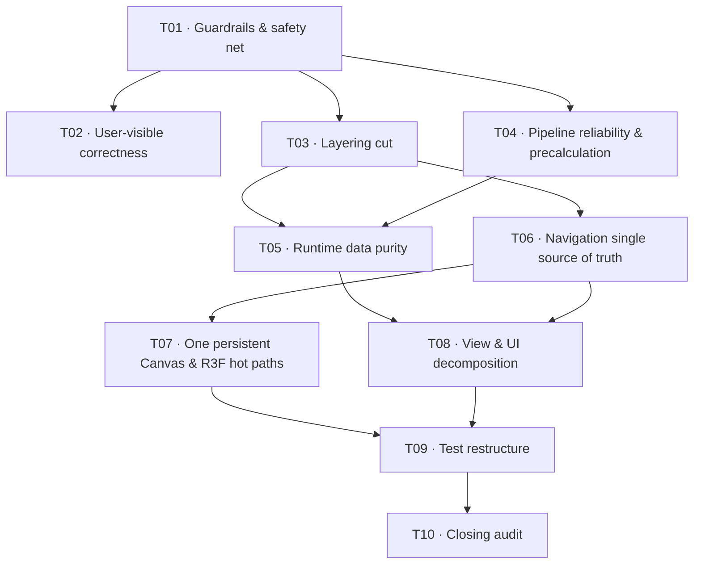

# Initiative: Architecture Remediation (`architecture-remediation`)

## Purpose

Fix every finding from the 2026-11-06 full architecture and implementation audit of `main` @ `4c45916`, **without breaking the site**. Every fix must be independently verified, and the guards must stop the same debt from coming back.

This initiative exists because the previous remediation (PR #84) declared several fixes complete that were not actually in the code. The root causes and the countermeasures are recorded in [decision-log.md](./decision-log.md) (DEC-R001 – DEC-R008).

## Governing Artifacts

- [Findings Ledger](./findings-ledger.md) — single source of truth for what is fixed. Every finding has an ID, an owning track, an acceptance check and a status. Only an end-of-track audit may set `verified`.
- [Verification Protocol](./verification-protocol.md) — end-of-track audit (three independent auditors + orchestrator spot-verification), regression suite, and the manual smoke checklist.
- [Decision Log](./decision-log.md) — programme-level and per-track decisions.

## Programme Rules

1. **One track = one PR.** Soft ceiling of ~40 production files; split into a follow-on track if larger.
2. **A track closes only when every ledger ID it owns is `verified`.** Partial fixes are reopened within the same track, never deferred silently.
3. **Guards before refactors.** Track 01 installs ratcheting guards and the behavioural safety net. Each later track must take its owned guard baselines to zero, and must never raise any baseline.
4. **The safety net stays green.** The e2e suite (existing specs + URL contract specs) and the manual smoke checklist must pass at the end of every track.
5. **Boy-scout testing.** Any module a track touches gets its tests moved or written as colocated 1:1 files.
6. **Feature freeze.** Stage 2 and standalone feature tracks are frozen until T08 merges (DEC-R003).

## Tracks

| # | Track | Folder | Status |
|---|---|---|---|
| T01 | Guardrails & safety net | [`architecture-remediation_01_guardrails-safety-net_20261106`](../../tracks/architecture-remediation_01_guardrails-safety-net_20261106/index.md) | [x] |
| T02 | User-visible correctness | [`architecture-remediation_02_user-visible-correctness_20261106`](../../tracks/architecture-remediation_02_user-visible-correctness_20261106/index.md) | [x] |
| T03 | Layering cut | [`architecture-remediation_03_layering-cut_20261106`](../../tracks/architecture-remediation_03_layering-cut_20261106/index.md) | [ ] |
| T04 | Pipeline reliability & precalculation | [`architecture-remediation_04_pipeline-reliability_20261106`](../../tracks/architecture-remediation_04_pipeline-reliability_20261106/index.md) | [ ] |
| T05 | Runtime data purity | [`architecture-remediation_05_runtime-data-purity_20261106`](../../tracks/architecture-remediation_05_runtime-data-purity_20261106/index.md) | [ ] |
| T06 | Navigation single source of truth | [`architecture-remediation_06_navigation-ssot_20261106`](../../tracks/architecture-remediation_06_navigation-ssot_20261106/index.md) | [ ] |
| T07 | One persistent Canvas & R3F hot paths | [`architecture-remediation_07_persistent-canvas_20261106`](../../tracks/architecture-remediation_07_persistent-canvas_20261106/index.md) | [ ] |
| T08 | View & UI decomposition | [`architecture-remediation_08_ui-decomposition_20261106`](../../tracks/architecture-remediation_08_ui-decomposition_20261106/index.md) | [ ] |
| T09 | Test restructure | [`architecture-remediation_09_test-restructure_20261106`](../../tracks/architecture-remediation_09_test-restructure_20261106/index.md) | [ ] |
| T10 | Closing audit | [`architecture-remediation_10_closing-audit_20261106`](../../tracks/architecture-remediation_10_closing-audit_20261106/index.md) | [ ] |

## Closure Criteria

- Every ledger ID is `verified`.
- A fresh six-area audit (T10) raises no new Critical/High findings.
- All guard baselines are at zero and the guards are permanent CI gates.
- Target architecture is promoted to `docs/`, and the initiative tracks are archived.
