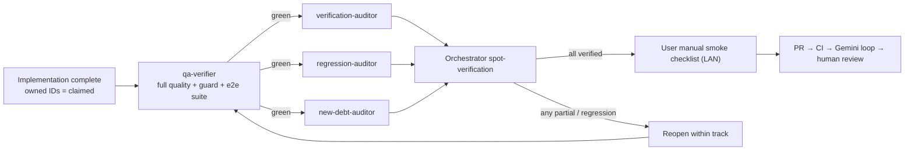

# Verification Protocol (`architecture-remediation`)

Every track in this initiative closes with the protocol below. It exists so that "fixed" is established by independent evidence, not by the implementer's own claim (DEC-R008).

## 1. Roles

| Role | Model | Write access | Responsibility |
|---|---|---|---|
| Orchestrator | main agent | conductor docs only | Decisions, ledger, spot-verification, artifacts, PR loop |
| `codebase-researcher` | flash | no | Pre-track reconnaissance and evidence gathering |
| `tdd-worker` | flash | yes | Red/green/refactor of ratified decisions; may set ledger IDs to `claimed` (via orchestrator) |
| `qa-verifier` | flash | yes (mechanical fixes only) | `lint`, `typecheck`, `test:coverage`, `audit:r3f`, `audit:ui`, guard suite, `test:e2e`, each as a single command |
| `screenshot-capturer` | flash | yes | `npm run capture:views` × 5 viewports into `/tmp/starmap-screenshots` |
| `verification-auditor` | flash | no | Per-ID verdicts with evidence |
| `regression-auditor` | flash | no | e2e suite, URL contracts, capture review, performance budget |
| `new-debt-auditor` | flash | no | `code-review` skill applied to the track diff only |

The three auditors run in **fresh contexts** and must not have implemented any task in the track under audit.

## 2. End-of-Track Audit

### 2.1 Verification auditor
- **Input:** ledger rows owned by the track; `git diff main...HEAD`.
- **For each ID:** re-run its acceptance check, then read the cited locations and any new code paths.
- **Output per ID:** `Fixed` / `Partial` / `Not fixed`, with file:line evidence and the acceptance-check output. Unsupported verdicts are invalid.

### 2.2 Regression auditor
- Runs `npm run test:e2e` (all specs, including the URL contract specs from T01) and reports pass/fail per spec.
- Runs `npm run capture:views` across the 5 standard viewports and lists anything visibly broken (empty canvas, missing panels, overflow, error boundaries).
- Compares the frame-time numbers from `canvas-interaction-and-fps.spec.ts` against the recorded baseline.
- Lists every route touched by the diff that is **not** covered by an e2e spec, so it can be added to the manual checklist for this track.

### 2.3 New-debt auditor
- Applies `.agents/skills/code-review/SKILL.md` to the diff only.
- Flags new literals, casts, shims, oversized files, missing quads, new lint warnings and any guard baseline increase.

### 2.4 Orchestrator spot-verification (DEC-R007, provisional)
- Re-verify **every** Critical/High verdict, plus a 1-in-3 sample of the others, directly against source.
- Record every false verdict in the track's audit report. The false-verdict rate decides whether DEC-R007 tightens.
- Only after this may ledger statuses move to `verified`.

### 2.5 Audit report
Each track writes `conductor/tracks/<track>/audit-report.md` containing: verdict table per ID, e2e results, capture findings, new-debt findings, spot-verification log (including false verdicts) and the final ledger delta.

## 3. Manual Smoke Checklist

Run over LAN (`http://192.168.1.124:5173`) on desktop **and** a phone before approving each track's PR. Tracks append track-specific steps (from §2.2) below the baseline list in their own `audit-report.md`.

### Baseline (every track)

**Galaxy (`/galaxy`)**
- [ ] Map renders with grid, rings and star reticles; no console errors.
- [ ] Orbit, pan and zoom feel smooth; no frame hitches when hovering reticles.
- [ ] Clicking a star selects it (reticle state + details panel) without a camera jump.
- [ ] Hover labels appear without flicker or position jumps.
- [ ] Browser back/forward restores the previous selection and focus.
- [ ] Refreshing a `/galaxy?focus=<id>&select=<id>` URL restores the same state.

**System (`/system/<id>`) and Planet (`/planet/<id>`)**
- [ ] Navigating galaxy → system → planet and back works; the camera frames the target each time.
- [ ] Orbits and bodies render; the bodies panel lists the expected planets.
- [ ] Details panel telemetry matches the selected body.
- [ ] Refreshing a deep link restores the same view and focus.

**Search (`/search` and the docked search)**
- [ ] Typing shows results without input lag or lost characters.
- [ ] Choosing a result focuses it on the map and updates the URL.
- [ ] Clicking outside dismisses the panel without click-through to the canvas.

**Guide (`/guide/*`)**
- [ ] Star types, planet types, metrics and hazards list and detail pages render.
- [ ] Metric comparison from a focused entity (`?focus=`) shows that entity's values.

**Directions / journeys**
- [ ] A two-point route can be planned; propulsion options and figures appear.

**Layers**
- [ ] Toggling a canon/overlay layer shows its entities; layer cards step through items.

**Mobile**
- [ ] Detent sheet drags between levels; panels do not overlap the canvas controls.
- [ ] No pull-to-refresh or tap-flash on canvas interaction.
