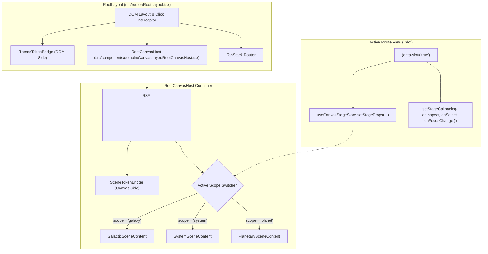

# 3D Canvas Management & WebGL Lifecycle Specification

This document provides the authoritative architectural specification for Starmap's WebGL rendering pipeline, React Three Fiber (R3F) integration, canvas persistence, scene management, 60fps frame-loop performance, and headless 3D unit testing.

---

## 1. Single Persistent WebGL Canvas Architecture

Starmap renders all 3D cartography through a single, permanently mounted WebGL canvas. Rather than instantiating and destroying WebGL contexts across route changes, the canvas remains mounted at the application root for the entire lifetime of the browser session.



### 1.1 WebGL Context Survival & Zero Context Rebuilding
Creating a WebGL context is computationally expensive: shader programs must be compiled, GPU pipeline state objects allocated, and textures uploaded to video memory. Tearing down and reconstructing a canvas during route transitions introduces:
1. Visible frame stutter and black flashes.
2. GPU garbage collection spikes and potential memory leaks in mobile WebGL drivers.
3. Shader recompilation pipeline stalls.

To eliminate these defects, `<Canvas>` is mounted exclusively inside `RootCanvasHost` (`src/components/domain/CanvasLayer/RootCanvasHost.tsx`), which sits directly inside `RootLayout` (`src/router/RootLayout.tsx`). The WebGL context survives all route navigations, selection changes, and UI state mutations.

### 1.2 Absence of `@react-three/drei <View>` Scissor-Testing
Starmap deliberately does **not** use `@react-three/drei <View>` scissor-testing. In high-density astronomical visualization, multiple active scissor viewports introduce per-frame draw-call overhead, synchronization complexities with scrolling DOM containers, and touch/wheel gesture conflicts. Instead, Starmap uses a single full-bleed viewport where scenes are swapped declaratively via stage slots.

---

## 2. Declarative `<CanvasLayer>` Stage Slots

Views communicate with the persistent 3D canvas via declarative stage slots powered by `useCanvasStageStore` (`src/stores/useCanvasStageStore.ts`).

### 2.1 The Slot Registration Pattern
When a view (such as `GalaxyView`, `SystemView`, or `PlanetView`) requires 3D rendering, it mounts a `<CanvasLayer>` component with its desired props:

```tsx
<CanvasLayer
  scope="galaxy"
  centerId={centerId}
  focusedTargetName={focusedTargetName}
  onInspect={handleInspect}
  onSelect={handleSelect}
  onFocusChange={handleFocusChange}
/>
```

When `RootCanvasHost` is mounted in the document:
1. `CanvasLayer` detects that `isRootCanvasMounted === true` and `isRootHost === false`.
2. It registers its presence by calling `mountSlot()` on mount and `unmountSlot()` on unmount.
3. It synchronises stage properties (`setStageProps`) and event callbacks (`setStageCallbacks`) into `useCanvasStageStore`.
4. It renders a lightweight, non-WebGL DOM slot marker (`data-slot="true"` and `data-testid="canvas-layer-slot"`) that reflects scope and telemetry for accessibility and testing.
5. If no view provides an active stage slot (`activeSlotCount === 0`), `RootCanvasHost` sets `data-stage-inactive="true"`, placing the 3D stage into a dormant, low-overhead state.

### 2.2 Direct Scene Children & Scope Switching
Inside the persistent `<Canvas>`, `RootCanvasHost` consumes the active stage props and swaps between direct scene components:
- `scope === 'galaxy'`: Renders `<GalacticSceneContent>` (parsec-scale stellar cartography, travelling fins, galactic datum).
- `scope === 'system'`: Renders `<SystemSceneContent>` (AU-scale Keplerian planetary orbits, invariant plane, host star).
- `scope === 'planet'`: Renders `<PlanetarySceneContent>` (kilometre-scale planetary disc, axial tilt, natural satellite orbits).

---

## 3. Theme Synchronisation via `ThemeTokenBridge`

WebGL materials and clear colours must respond immediately to light and dark theme toggling without remounting the canvas or tearing down Three.js meshes.

```
[ DOM: HTML Document ] ──► [ ThemeTokenBridge ] ──► [ useThreeTokenStore ] ──► [ SceneTokenBridge ] ──► [ Three.js Scene ]
(CSS Custom Properties)      (Resize/MutationObserver)   (Reactive Hex Cache)     (Canvas In-Place Sync)    (Materials & Background)
```

1. **DOM Side (`ThemeTokenBridge`):** Mounted in `RootLayout`. Observes CSS custom properties on `:root` and updates `useThreeTokenStore` (`src/stores/useThreeTokenStore.ts`).
2. **Canvas Side (`SceneTokenBridge`):** Mounted inside the persistent `<Canvas>`. Reads hexadecimal colour tokens from `useThreeTokenStore` and synchronises renderer clear colours and ambient scene parameters in-place via Three.js `.setHex()` / `.copy()`.
3. **Zero Shader Recompilation:** Materials consume uniforms or direct attribute buffers; theme changes never alter shader source code or invalidate compiled program caches.

---

## 4. 60fps Frame-Loop Guardrails & Zero Allocations

The 3D cartography engine runs at a locked 60fps. Every frame callback (`useFrame`) executes within a strict 16.6ms budget. Any memory allocation inside `useFrame` triggers garbage collection pauses, producing noticeable frame drops.

### 4.1 Strict Allocation Rules
- **Zero Object Instantiation in `useFrame`:** Creating new `THREE.Vector3`, `THREE.Matrix4`, `THREE.Color`, or plain JavaScript objects/arrays inside `useFrame` is strictly prohibited and enforced by `npm run audit:r3f`.
- **Scratch Objects via `useLazyRef`:** Reusable scratch vectors, quaternions, matrices, and boxes are allocated once per component lifecycle using `useLazyRef()`:
  ```tsx
  const scratchWorldPos = useLazyRef(() => new THREE.Vector3());
  const scratchBox = useLazyRef<Box2D>(() => ({ left: 0, top: 0, right: 0, bottom: 0 }));
  ```
- **Zero Zustand Store Subscriptions in `useFrame`:** Components must never call `useStore.getState()` or trigger reactive state setters inside `useFrame`. Data flow into the frame loop occurs via mutable references or batch registries.

### 4.2 Lifecycle-Only Occlusion Registration & $O(N)$ Batch Pass
To prevent $O(N^2)$ collision cascades when resolving reticles and labels across thousands of celestial entities:
1. **Lifecycle-Only Registration:** Entities register their screen footprint in `celestialOcclusionRegistry.ts` on mount, state change, or scope switch—never on every raw tick.
2. **`other.hasReticle` Filtering:** Ambient background entities without visible reticles (`state === 'passive'`) are excluded from reticle-to-reticle collision tests.
3. **Single `OcclusionPass` Batch Pass:** Mounted once inside the scene (`src/components/canvas/entity/OcclusionPass.tsx`), evaluating screen-space projections, priority occlusion masking, and proximity culling across all registered footprints in a single linear $O(N)$ pass per frame.

### 4.3 `EntityLabel` Optimization & `ResizeObserver` Caching
Typographic labels rendered in HTML via `<SafeHtml>` (`src/components/canvas/entity/EntityLabel.tsx`) adhere to strict performance rules:
- **`ResizeObserver` Dimension Caching:** Label dimensions (`width`, `height`) are observed asynchronously and cached in `labelDimensionsRef`. Synchronous DOM layout reads (`getBoundingClientRect()`, `offsetWidth`) are strictly forbidden inside the render path.
- **Hardware-Accelerated Transforms:** Displaced labels update positions exclusively via `style.transform = 'translate3d(x, y, 0)'` and communicate visibility through HTML `data-occluded` attributes, bypassing React re-renders.

### 4.4 Material Stability in `CartoLineMaterial`
Cartographic lines (orbits, travelling fins, range rings, stalks) utilise `CartoLineMaterial` (`src/components/canvas/materials/CartoLineMaterial.ts`), which extends Three.js `LineMaterial`:
- **Screen-Space Perspective Invariance:** Evaluates dashes and dots using perspective-invariant screen pixel coordinates (`gl_FragCoord.w * uResolutionScale`).
- **In-Place Uniform Updates:** Styles (`solid`, `dashed`, `dotted`), colours, and opacities mutate via `.setColor()` and `.setOpacity()`. Materials are never destroyed or re-instantiated when state transitions occur.

### 4.5 Raycasting, Matrix World & Drag Threshold in `BodyMarker`
Entity markers (`src/components/canvas/entity/BodyMarker.tsx`) provide pixel-precise interaction:
- **`updateMatrixWorld(true)`:** When billboard orientation or screen-invariant scaling changes, `billboardRef.current.updateMatrixWorld(true)` is invoked explicitly before raycast hit-testing, eliminating single-frame positional lag.
- **8px Drag Threshold:** To prevent camera panning or rotation gestures from accidentally selecting celestial bodies, `BodyMarker` tracks pointer down positions and suppresses click events if pointer displacement exceeds 8 pixels (`Math.hypot(x - startX, y - startY) > 8`).

---

## 5. Headless 3D Scene-Graph Testing with `@react-three/test-renderer`

Following the elimination of monkey-patched prototype shims (`patchR3F.ts` deleted per `DEC-R046`), all 3D canvas components are tested natively using `@react-three/test-renderer`:

1. **Pure Scene-Graph Verification:** `@react-three/test-renderer` mounts components into a virtual Three.js graph without requiring a physical WebGL GPU context, X11 display, or headless Chrome instance.
2. **Direct Scene Queries:** Tests inspect Three.js scene-graph objects via standard predicates:
   ```tsx
   import ReactThreeTest from '@react-three/test-renderer';

   const renderer = await ReactThreeTest.create(<GalacticSceneContent />);
   const markers = renderer.scene.findAll((node) => node.props.userData?.testId === 'body-marker');
   expect(markers.length).toBeGreaterThan(0);
   ```
3. **Colocated 1:1 Coverage:** Every 3D canvas component (`src/components/canvas/**`) maintains its own colocated `.test.tsx` file running in the `unit:dom` Vitest project.
