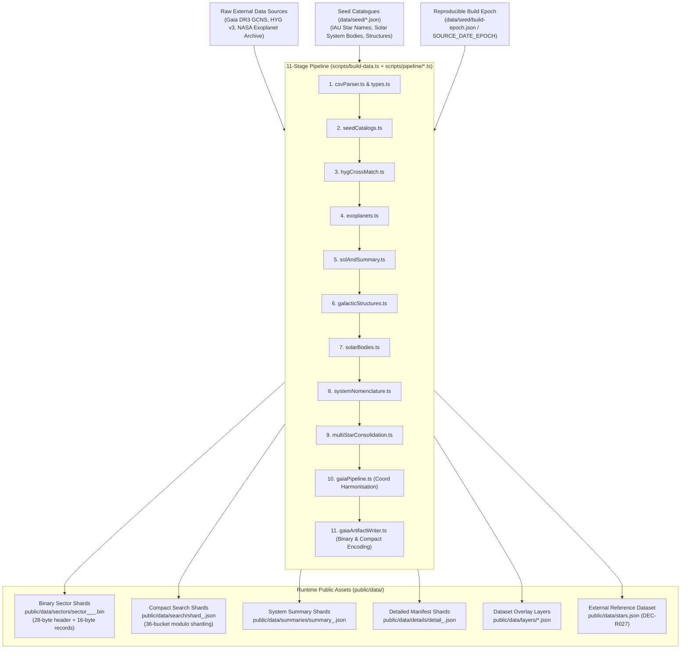

# Data Pipeline & Codecs Architecture Specification

This document provides the authoritative architectural specification for Starmap's deterministic offline data pipeline, hardened source ingestion, binary sector partitions, compact JSON sharding, precalculated domain attributes, and data codecs.

---

## 1. Deterministic Offline Data Pipeline

Starmap processes millions of raw astronomical measurements from Gaia DR3, HYG v3, and NASA Exoplanet Archive into precalculated, optimized runtime assets. The entire build pipeline is fully deterministic and executes offline via Node.js / `tsx`.



### 1.1 The 11 Modular Pipeline Stages (`scripts/pipeline/`)
1. **`types.ts`:** Strongly typed interfaces for pipeline ingest records and astronomical entities.
2. **`csvParser.ts`:** High-performance streaming CSV parser with type coercion and memory-efficient chunking.
3. **`seedCatalogs.ts`:** Ingestion and validation of version-controlled seed data.
4. **`hygCrossMatch.ts`:** Ingests HYG v3, resolves Bayer/Flamsteed designations, cross-matches SIMBAD coordinates, and synchronises official IAU proper names.
5. **`exoplanets.ts`:** Ingests the NASA Exoplanet Archive (PS/PSCompPars), derives habitability status, and computes Keplerian orbital elements ($a, e, i, \omega, \Omega, M$).
6. **`solAndSummary.ts`:** Constructs the canonical Sol baseline and generates multi-tier summary records for nearby star systems.
7. **`galacticStructures.ts`:** Incorporates open clusters, nebulae, historical milestones, and deep sky markers.
8. **`solarBodies.ts`:** Builds hierarchical orbital trees for solar system planets, dwarf planets, moons, and minor bodies.
9. **`systemNomenclature.ts`:** Resolves catalog identifier aliases, Gliese variations, and clean search keys.
10. **`multiStarConsolidation.ts`:** Groups physical binary, trinary, and multiple stars around gravitational barycentres at parsec scales.
11. **`gaiaArtifactWriter.ts`:** Encodes binary sector partitions and serialises compact JSON shards into `public/data/`.

### 1.2 Reproducibility & Epoch Management
Deterministic builds ensure that compiling the pipeline produces bit-for-bit identical assets:
- **Build Epoch (`data/seed/build-epoch.json`):** Holds a fixed ISO-8601 timestamp (`"2026-01-01T00:00:00.000Z"`). Build scripts consume this timestamp or `SOURCE_DATE_EPOCH` rather than calling `new Date()`.
- **`npm run data:refresh`:** Invoked explicitly when refreshing seed catalogues or pulling updated astronomical releases (`scripts/fetch-sources.ts --force --refresh-epoch && tsx scripts/build-data.ts`), updating the epoch file deliberately.

---

## 2. Hardened Source Fetching (`scripts/fetch-sources.ts`)

Astronomical catalog downloads are hardened against network instability:
- **Retry Logic:** Exponential backoff with configurable retries (`maxRetries: 3`, initial delay `1000ms`).
- **Timeouts:** Configurable socket timeouts (`timeoutMs: 30000`) preventing stalled downloads.
- **Registry & Checksums:** All external sources are declared in `scripts/sources.config.ts` (`DATA_SOURCES_REGISTRY`), verifying content headers and local file integrity before ingestion.

---

## 3. Versioned Seed Catalogues (`data/seed/`)

Curated astronomical and nomenclature catalogues are checked into version control under `data/seed/`:
- `iau-star-names.json`: Official IAU Working Group on Star Names (WGSN) proper names.
- `name-exoworlds.json`: IAU NameExoWorlds approved designations for stars and exoplanets.
- `recons-10pc.json`: Research Consortium on Nearby Stars (RECONS) 10-parsec census additions.
- `solar-system-bodies.json`: High-precision orbital elements and physical properties for Solar System bodies.
- `galactic-structures.json`: Curated landmarks, open clusters, and navigational markers.
- `circumstellar-disks.json`: Known debris disks and protoplanetary rings.
- `constellations.json`: Standard 88 IAU constellation boundaries and asterisms.
- `system-aliases.json`: Literature cross-references and sci-fi franchise system alignments.
- `aavso-variables.json`: American Association of Variable Star Observers classifications.

---

## 4. Binary Sector Shards (`v: 1`, 28-Byte Header)

To support rendering tens of thousands of stars across the 100pc volume at 60fps on low-power devices, spatial partitions are encoded in a compact, 16-byte aligned binary format (`binarySectorCodec.ts`):

```
File: public/data/sectors/sector_<x>_<y>_<z>.bin
```

### 4.1 Binary Layout Specification

#### Header (28 bytes)
| Byte Offset | Type | Field | Description |
| :---: | :---: | :--- | :--- |
| `0x00 .. 0x03` | `Uint32` | `magic` | Magic identifier `0x52415453` (ASCII `'STAR'`, little-endian) |
| `0x04 .. 0x07` | `Uint32` | `version` | Format version (`1`) |
| `0x08 .. 0x0B` | `Uint32` | `count` | Number of star records in this sector ($N$) |
| `0x0C .. 0x0F` | `Float32` | `originX` | Sector minimum X coordinate in parsecs |
| `0x10 .. 0x13` | `Float32` | `originY` | Sector minimum Y coordinate in parsecs |
| `0x14 .. 0x17` | `Float32` | `originZ` | Sector minimum Z coordinate in parsecs |
| `0x18 .. 0x1B` | `Float32` | `sectorSize`| Spatial cube side length (typically `25.0` parsecs) |

#### Body Records ($N \times 16$ bytes)
Beginning at byte offset 28 (`0x1C`), each star record occupies 16 contiguous bytes:
| Relative Offset | Type | Field | Description |
| :---: | :---: | :--- | :--- |
| `+0x00` | `Float32` | `x` | Galactic X coordinate in parsecs |
| `+0x04` | `Float32` | `y` | Galactic Y coordinate in parsecs |
| `+0x08` | `Float32` | `z` | Galactic Z coordinate in parsecs |
| `+0x0C` | `Uint32` | `idHash` | 32-bit FNV-1a hash of the entity identifier string |

### 4.2 Zero-Copy WebGL Buffers
When fetched by the client, `decodeBinarySector()` creates zero-copy typed array views directly over the `ArrayBuffer`:
- `positions: Float32Array` (length $3N$, offset 28) passes straight into Three.js `BufferAttribute` without parsing or iteration.
- `ids: Uint32Array` (length $N$) facilitates instantaneous $O(1)$ entity hit-testing and shard key resolution via `getShardKeyFromHash(idHash)`.

---

## 5. Compact JSON Sharding & Codecs

For rich text metadata, search indices, and detailed orbital dossiers, Starmap uses dense, array-tuple JSON envelopes (`compactDataCodec.ts` and `datasetLayerCodec.ts`):

### 5.1 FNV-1a 32-Bit Hashing & Modulo-36 Sharding
Entity IDs are hashed deterministically using 32-bit FNV-1a:
$$\text{shardKey} = (\text{fnv1a32}(\text{id}) \pmod{36})\text{.toString}(36)$$
This distributes search indices, summaries, and detailed manifests uniformly across 36 buckets (`0`–`9`, `a`–`z`), guaranteeing bounded file sizes ($\le 150\text{ KB}$) and predictable caching:
- `public/data/search/shard_<key>.json`
- `public/data/summaries/summary_<key>.json`
- `public/data/details/detail_<key>.json`

### 5.2 Dense Array-Tuple Schema (`COMPACT_SCHEMA_VERSION = 1`)
Rather than serialising verbose JSON object keys (`{ "id": "...", "name": "..." }`), search entries and summaries are encoded as packed arrays:
```json
["sol", "Sol", 0, 0, 0, "G2V", 8, 1, 0, 0]
```
Decoded via `compactDataCodec.ts`, this schema reduces compressed payload sizes by over 70% while parsing significantly faster than nested JSON trees.

### 5.3 Bitmask Compression
Categorical and physical attributes are packed into bitmasks:
- **Hazard Status:** `computePlanetHazardMask()` packs radiation, extreme thermal, tidal, and rotational hazards into an integer bitfield.
- **Tags & Features:** Binary flags (`hasExoplanets`, `isHabitableCandidate`, `isMultiStar`, `isMajorLandmark`) are stored as single bitmask integers.

---

## 6. Precalculated Domain Attributes (`astroPrecalculation.ts`)

To strictly uphold the **Zero Hardcoded Entity Attributes** rule (`G-literals`), no astronomical logic or classification is computed in runtime UI or service components. Everything displayed in dossiers and panels is precomputed during the build step:

- **Bulk Density & Gravity:** Surface gravity ($g$) and bulk density ($\text{g/cm}^3$) are computed using standard IAU physical equations.
- **Habitable Candidates:** `isPlanetHabitableCandidate()` evaluates equilibrium temperatures and stellar flux models at build time.
- **Composition Breakdown:** `computePlanetCompositionCounts()` determines iron/silicate/volatile mixes during data compilation.
- **Classification & Symbology:** Spectral types and planetary classifications are resolved deterministically into regulated symbol types.

---

## 7. Role of `public/data/stars.json` (`DEC-R027`)

`public/data/stars.json` is retained strictly as an **external reference dataset and validation baseline** (`DEC-R027`):
- It is never fetched or loaded by the runtime client application.
- The client application exclusively requests binary sector shards (`.bin`) and partitioned compact JSON envelopes.
- `stars.json` remains available for offline verification, research scripts, and scientific cross-validation against upstream catalogs.
