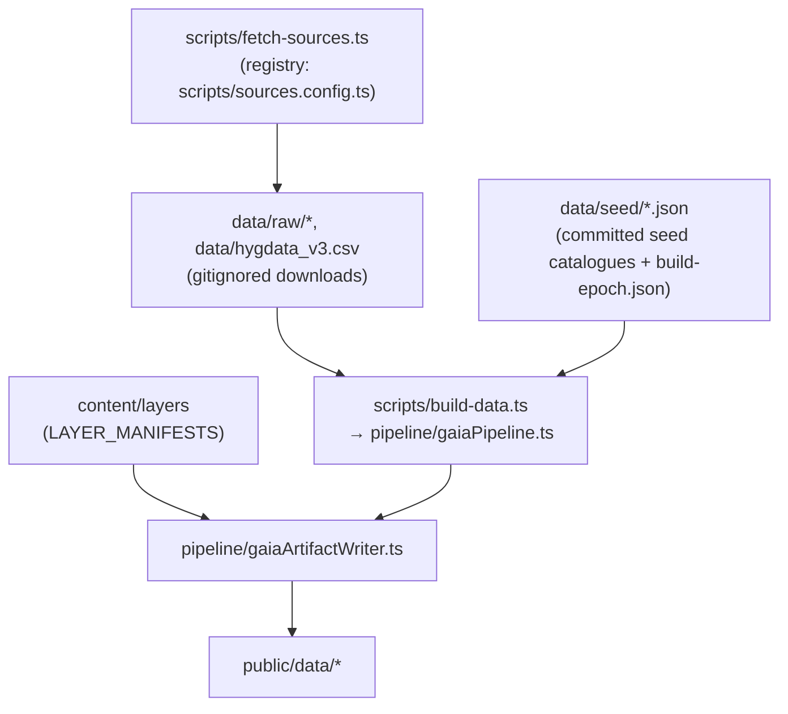

# Data Pipeline Architecture

Starmap's runtime assets are produced by a deterministic, offline Node.js pipeline (`tsx`). The browser loads only the precalculated files under `public/data/`; it never reads raw catalogues. File layouts, envelopes and codecs are specified in [data-formats.md](../reference/data-formats.md); upstream sources are listed in [data-sources.md](../reference/data-sources.md).

---

## 1. Flow

`npm run data:pipeline` runs `data:fetch` then `data:build`. `npm run data:refresh` forces a re-fetch, refreshes the build epoch and rebuilds.

## 2. Entry points

| Script | Role |
| :--- | :--- |
| `scripts/fetch-sources.ts` | Walks `DATA_SOURCES_REGISTRY` (enabled sources). Downloads each `remoteUrl` into its `localCachePath` unless a non-empty cache exists (`--force` re-downloads). `declarative-seed` sources are only verified against `data/seed/`. Downloads use a 30 s timeout and up to 3 retries with exponential backoff (500 ms base). `--refresh-epoch` rewrites `data/seed/build-epoch.json`. |
| `scripts/build-data.ts` | CLI wrapper around `buildStarDataPipeline`. Output directories default to `public/data/{catalogs,partitions,systems,overlays,sol,summaries,details,search}` and can be overridden with `CATALOGS_DIR`, `PARTITIONS_DIR`, `SYSTEMS_DIR`, `OVERLAYS_DIR`, `SOL_DIR`, `SUMMARIES_DIR`, `DETAILS_DIR`, `SEARCH_DIR`; `GCNS_GZ` and `OUTPUT_JSON` override the input and the intermediate star list. Partitions cover stars within 100 pc. |

## 3. Pipeline modules (`scripts/pipeline/`)

| Module | Responsibility |
| :--- | :--- |
| `types.ts` | Pipeline option, summary and cross-match types. |
| `csvParser.ts` | Synchronous and streaming CSV/delimited parsing. |
| `seedCatalogs.ts` | Loads `data/seed/*.json`; resolves the deterministic build timestamp. |
| `hygCrossMatch.ts` | Loads HYG v3 and IAU proper names; matches Gaia sources to HYG by coordinates and magnitude; derives Gaia space velocities. |
| `exoplanets.ts` | Merges the Open Exoplanet Catalogue, NASA Exoplanet Archive and Exoplanet.eu tables; matches planets to host stars; classifies planets and derives habitability and census fields. |
| `solAndSummary.ts` | Builds the Sol manifest; matches circumstellar disks to stars; derives summary nodes. |
| `galacticStructures.ts` | Builds galactic structures from the seed plus Cantat-Gaudin, Harris, ATNF and OpenNGC raw tables when present. |
| `solarBodies.ts` | Builds Solar System bodies from the seed plus MPC distant, PHA and comet tables when present. |
| `systemNomenclature.ts` | Name-key helpers, duplicate-record detection and alias merging used during consolidation. |
| `multiStarConsolidation.ts` | Collapses physically associated multiples into a single system node. |
| `gaiaPipeline.ts` | Orchestrator: streams the gzipped GCNS table, ingests Gaia and HYG-only stars, adds the RECONS supplement, runs consolidation, then calls the writer. |
| `gaiaArtifactWriter.ts` | Writes every `public/data/` artefact (see §4). |
| `compactDataEncoder.ts`, `compactEntityEncoder.ts` | Compact encoders for summaries, system manifests, structures, Solar System bodies, and the 36-bucket `summaries/` and `details/` shards. |
| `datasetLayerEncoder.ts`, `datasetLayerSearchBuilder.ts` | Encode dataset layers and by-entity annotations; resolve real-sky names and layer search entries. |
| `searchIndexBuilder.ts`, `searchEntryIndexers.ts`, `solarSearchIndexer.ts` | Build the composite and category search indices. |

Shared maths (coordinates, sector ids, hazards, composition, habitability) lives in `src/utils/` and is imported by the pipeline so build-time and runtime agree: `astroCoordinates.ts`, `sectorMath.ts`, `astroHazards.ts`, `planetaryPhysics.ts`, `astroPrecalculation.ts`, `nomenclature.ts`, `starNaming.ts`.

## 4. Outputs (`public/data/`)

| Path | Content |
| :--- | :--- |
| `partitions/sector_<x>_<y>_<z>.bin` | Binary star positions per 25 pc sector (all stars ≤100 pc, including uncatalogued). |
| `systems/sector_<x>_<y>_<z>.json` | Detailed system manifests per sector (systems with planets, disks or mag ≤ 4). |
| `summaries/<0..z>.json` | 36-bucket dictionary shards of compact system summaries (catalogued systems). |
| `details/<0..z>.json` | 36-bucket dictionary shards of compact system, structure and Solar System body details. |
| `catalogs/*.json` | `solar-neighborhood-10pc` and `reference-bright-stars` catalogues. |
| `overlays/exoplanetary-systems.json`, `overlays/galactic-structures.json` | Topic overlays. |
| `overlays/layers/index.json`, `overlays/layers/<layerId>.json`, `overlays/layers/by-entity/<0..z>.json` | Dataset layers (fictional canon, custom, scientific overlays) and the by-entity annotation shards. |
| `sol/*.json` | Primary-body ephemeris, asteroid, NEO and comet orbital elements. |
| `search/{core,full,stars,planets,structures,minor-bodies,layers}.json` | Search indices. |

Writes are cumulative per directory: `partitions/` has stale `.json` files removed first; other directories are overwritten file by file.

## 5. Inclusion rules (from `gaiaPipeline.ts`)

- **Sector partitions:** every ingested star, grouped by `formatSectorId(x, y, z)` (25 pc cubes, `DEFAULT_SECTOR_SIZE_PC`).
- **Catalogued summaries and search:** a system is catalogued if it has a HYG match, lies within 10 pc, has V ≤ 6.5, or hosts a matched planet.
- **System manifests:** catalogued systems with planets, matched disks, or mag ≤ 4.0; Sol and RECONS supplements are always included.

## 6. Reproducibility

- **Build epoch:** timestamps come from `overrideEpoch` > `SOURCE_DATE_EPOCH` > `data/seed/build-epoch.json` (`resolveBuildTimestampIso`). The pipeline does not call `new Date()` for output timestamps.
- **Inputs:** `data/seed/` is committed; the rest of `data/` is gitignored (`/data/*`). Seed catalogues loaded by `seedCatalogs.ts`: `iau-star-names`, `recons-10pc`, `name-exoworlds`, `aavso-variables`, `galactic-structures`, `solar-system-bodies`, `circumstellar-disks`, `system-aliases`, `constellations`, plus `build-epoch`.

## 7. Precalculated attributes

Per the zero-hardcoding rule, runtime UI and services read derived attributes from decoded data rather than computing them: planet composition counts, habitable-candidate flags, planet census and system tag bitmasks, hazard masks, classification and reticle types, and `parentBodyId` hierarchy. Bit assignments live in `src/utils/compactDataConstants.ts`.

## 8. Retired: `public/data/stars.json`

The full star list is not published under `public/data/`. DEC-R027's clause retaining `public/data/stars.json` is **superseded**. `build-data.ts` still streams an intermediate full star list to `data/stars.json` (gitignored, not shipped); the client never fetches it. Publishing it as a GitHub Release asset is tracked in [conductor/backlog.md](../../conductor/backlog.md).
