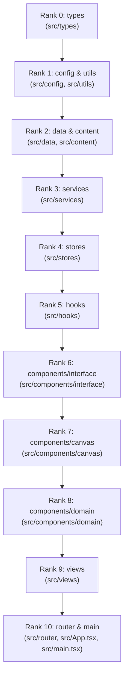

# Layering and Guardrails Architecture Specification

This document provides the authoritative architectural specification for Starmap's strict one-directional module layering, architectural boundary rules, import cycle prevention, and permanent automated CI guard suite.

---

## 1. Strict One-Directional Module Layer Hierarchy

To guarantee modularity, prevent tight coupling, and eliminate circular dependencies, Starmap enforces a strict one-directional dependency rank hierarchy across the entire `src/` codebase.

Modules at rank $N$ may only import from modules at rank $\le N$. Upward imports (where a lower-rank layer imports from a higher-rank layer) are strictly forbidden and enforced as errors by `oxlint` (`no-restricted-imports` in [`.oxlintrc.json`](../../.oxlintrc.json)).



### 1.1 Layer Rank Table & Responsibilities

| Rank | Layer Directory | Core Responsibility | Dependency Constraints |
| :---: | :--- | :--- | :--- |
| **0** | `src/types/` | Pure TypeScript type definitions and interfaces. | Zero runtime imports. Pure types only. |
| **1** | `src/config/`<br/>`src/utils/` | Configuration constants, math utilities, coordinate math, binary/compact codecs. | May import Rank 0 and Rank 1. Zero side-effects. |
| **2** | `src/data/`<br/>`src/content/` | Repositories, LRU caches, seed data, and Guide editorial modules. | May import Ranks 0–2. |
| **3** | `src/services/` | Search engines, transit calculation algorithms, and astronomical algorithms. | May import Ranks 0–3. |
| **4** | `src/stores/` | Zustand state stores (`useUIStore`, `useCameraStore`, etc.). | May import Ranks 0–4. |
| **5** | `src/hooks/` | Reusable React hooks, location adapters, and reactive store bindings. | May import Ranks 0–5. |
| **6** | `src/components/interface/` | Tier 1 Primitives (`Button`, `Stack`, `Datum`) and Tier 2 Surfaces (`Card`, `Panel`). | May import Ranks 0–1, 5. **Forbidden from importing `data`, `content`, `services`, or `stores`**. |
| **7** | `src/components/canvas/` | 3D WebGL cartography, materials, reticles, markers, and R3F components. | May import Ranks 0–6. |
| **8** | `src/components/domain/` | Application assemblies (`Search`, `DetailsPanel`, `BodiesPanel`, `DirectionsPanel`). | May import Ranks 0–7. |
| **9** | `src/views/` | Top-level routed views (`GalaxyView`, `SystemView`, `PlanetView`, `SearchView`). | May import Ranks 0–8. |
| **10** | `src/router/`<br/>`src/App.tsx`<br/>`src/main.tsx` | Route definitions, root layouts, and application bootstrap. | Top of hierarchy. May import all production layers. |

### 1.2 Interface Primitive Purity (`Rank 6`)
Tier 1 and Tier 2 interface primitives in `src/components/interface/` must remain pure, reusable design-system assets with zero knowledge of astronomical business logic. `.oxlintrc.json` enforces an explicit rule:
- **`components/interface` cannot import from `data`, `content`, `services`, or `stores`**.
Any attempt by a primitive to bind directly to a repository or global store fails `npm run lint`. For component design rules, see [Component Architecture](../../conductor/code_styleguides/components.md).

### 1.3 Zero Import Cycles & File Size Ceiling (`.oxlintrc.json`)
Circular dependencies (`A -> B -> A` or deep transitive loops) create initialisation order bugs and break bundler tree-shaking. `.oxlintrc.json` enforces:
- **`import/no-cycle: "error"`:** Ensures the entire codebase contains **zero** import cycles.
- **`max-lines: "error"`:** Enforces a 300-line ceiling (skipping blank lines and comments) across production source files, exempting tests, stories, `scripts/`, `e2e/`, `tests/`, and `content/`.

---

## 2. Permanent Automated CI Guard Suite

Each static analysis tool owns a distinct, non-overlapping concern and is run once via the unified `npm run check` gate:

```
npm run check         ──► Single-pass gate: lint -> typecheck -> audit:guards -> audit:ui -> audit:r3f
npm run lint          ──► Oxlint (Layering, Import Cycles, 300-Line Ceiling, React Hooks)
npm run typecheck     ──► TypeScript Project References (tsc -b)
npm run audit:guards  ──► Domain Literal Guard (G-literals: Zero Hardcoded Celestial Entities)
npm run audit:ui      ──► Design System, Component Quads, CUBE CSS, Zero Inline Styles
npm run audit:r3f     ──► 60fps Three.js Frame Loop Memory & Performance Audits
```

### 2.1 Domain Literal Guard (`scripts/audit-guards.ts`)
`audit:guards` focuses exclusively on **`G-literals` (Zero Hardcoded Celestial Entities)**:
- Scans TypeScript ASTs in `src/` (excluding tests, stories, `src/config/`, and `src/content/`) to verify that celestial entity IDs, names, and classifications are not hardcoded into runtime code. All entities must be read from precalculated data pipeline shards.
- Flags suspicious non-zero numeric fallbacks (`?? <num>`, `|| <num>`) on astronomical telemetry in `src/services/`, `src/components/canvas/`, and `src/views/`.
- Fails closed on parse errors or unexpected exceptions.

### 2.2 Design System Guard Suite (`scripts/audit-ui.ts`)
Enforces strict design system standards across `src/components/` and `src/views/` (see [HTML & CSS Style Guide](../../conductor/code_styleguides/html-css.md)):
- **`missing-component-quad`:** Every component in `interface/` and `domain/` must have all 4 quad files: `<Component>.tsx`, `<Component>.module.css`, `<Component>.stories.tsx`, and `<Component>.test.tsx`.
- **`forbidden-raw-element`:** Disallows raw HTML controls (`<button>`, `<input>`, `<select>`) or telemetry lists (`<dl>`, `<ul>`, `<ol>`); domain views must compose Tier 1 primitives.
- **`forbidden-dynamic-classname`:** Disallows dynamic `className` concatenation; state and variant styling must consume HTML `data-*` attributes.
- **`forbidden-inline-style`:** Zero `style={{ ... }}` attributes; all styling lives in scoped CSS Modules.
- **`forbidden-rendertostring`:** Disallows `renderToString` in unit tests; all tests must render via `@testing-library/react` in `jsdom`.
- **`missing-layer-blocks`:** Component stylesheets must declare `@layer blocks` and `@layer exceptions`.
- **`forbidden-outer-margin`:** Components must never declare outer `margin` or self-layout. Layout rhythm is owned by layout primitives (`<Stack>`, `<Cluster>`, `<Grid>`).
- **`hardcoded-hex-color` & `hardcoded-css-token`:** Disallows literal hex codes (`#ffffff`) or pixel values; all CSS must consume semantic tokens (`var(--token)`).

### 2.3 WebGL & Frame-Loop Guard Suite (`scripts/audit-r3f.ts`)
Enforces 60fps WebGL execution guardrails (see [WebGL, Three.js & R3F Style Guide](../../conductor/code_styleguides/webgl-r3f.md)):
- Flags any object instantiation (`new THREE.Vector3()`, `new THREE.Matrix4()`, `new Object()`, array literals `[]`) inside `useFrame` callbacks.
- Flags Zustand store subscriptions or state mutations inside `useFrame`.
- Flags whole-store or broad object subscriptions in canvas components (`atomic-store-selectors`).
- Verifies material and geometry reuse across instances.

---

## 3. Zero-Tolerance Policy & Justified Suppressions

All static analysis suites operate with zero-tolerance, fail-closed enforcement (no baseline grandfathering):

1. **Zero Influx:** Any violation across `oxlint`, `tsc`, `audit:guards`, `audit:ui`, or `audit:r3f` immediately fails `npm run check` and CI.
2. **Justified Suppressions Only:** Inline suppressions (`// guard-disable-next-line <rule> -- <reason>`, `/* ui-audit-disable-next-line <rule> -- <reason> */`, or `// r3f-audit-disable-next-line <rule> -- <reason>`) require an explicit technical justification after `-- <reason>`. Unreasoned suppression comments are flagged as errors.

---

## 4. End-to-End Visual and Performance Baselines

In addition to static AST audits, Playwright executes automated contracts against the built application:

- **URL Contracts (`e2e/url-contracts.spec.ts`):** Validates that all canonical deep-links, guide slugs, and orthogonal search query parameters resolve deterministically.
- **Frame-Time Baseline (`e2e/frame-time-baseline.spec.ts`):** Measures real-world 60fps rendering performance under continuous camera orbit and zoom operations, ensuring frame times remain within the 16.6ms budget (`scripts/guards/frame-time-baseline.json`).
