# Layering and Guardrails Architecture Specification

This document provides the authoritative architectural specification for Starmap's strict one-directional module layering, architectural boundary rules, import cycle prevention, and permanent automated CI guard suite.

---

## 1. Strict One-Directional Module Layer Hierarchy

To guarantee modularity, prevent tight coupling, and eliminate circular dependencies, Starmap enforces a strict one-directional dependency rank hierarchy across the entire `src/` codebase.

Modules at rank $N$ may only import from modules at rank $\le N$. Upward imports (where a lower-rank layer imports from a higher-rank layer) are strictly forbidden and enforced by AST analysis in `scripts/audit-guards.ts` (`G-imports`).

```mermaid
flowchart TD
    L0["Rank 0: types\n(src/types)"]
    L1["Rank 1: config & utils\n(src/config, src/utils)"]
    L2["Rank 2: data & content\n(src/data, src/content)"]
    L3["Rank 3: services\n(src/services)"]
    L4["Rank 4: stores\n(src/stores)"]
    L5["Rank 5: hooks\n(src/hooks)"]
    L6["Rank 6: components/interface\n(src/components/interface)"]
    L7["Rank 7: components/canvas\n(src/components/canvas)"]
    L8["Rank 8: components/domain\n(src/components/domain)"]
    L9["Rank 9: views\n(src/views)"]
    L10["Rank 10: router & main\n(src/router, src/App.tsx, src/main.tsx)"]
    
    Isolated["Rank 99: prototypes (Isolated)\n(src/prototypes, src/components/prototypes)"]

    L0 --> L1 --> L2 --> L3 --> L4 --> L5 --> L6 --> L7 --> L8 --> L9 --> L10
    
    style Isolated fill:#2a1b1b,stroke:#e06c75,stroke-dasharray: 5 5
```



### 1.1 Layer Rank Table & Responsibilities

| Rank | Layer Directory | Core Responsibility | Dependency Constraints |
| :---: | :--- | :--- | :--- |
| **0** | `src/types/` | Pure TypeScript type definitions and interfaces. | Zero runtime imports. Pure types only. |
| **1** | `src/config/`<br/>`src/utils/` | Configuration constants, math utilities, coordinate math, binary/compact codecs. | May import Rank 0. Zero side-effects. |
| **2** | `src/data/`<br/>`src/content/` | Repositories, LRU caches, seed data, and Guide editorial modules. | May import Ranks 0–1. |
| **3** | `src/services/` | Search engines, transit calculation algorithms, and astronomical algorithms. | May import Ranks 0–2. |
| **4** | `src/stores/` | Zustand state stores (`useUIStore`, `useCameraStore`, etc.). | May import Ranks 0–3. |
| **5** | `src/hooks/` | Reusable React hooks, location adapters, and reactive store bindings. | May import Ranks 0–4. |
| **6** | `src/components/interface/` | Tier 1 Primitives (`Button`, `Stack`, `Datum`) and Tier 2 Surfaces (`Card`, `Panel`). | May import Ranks 0–1, 5. **Forbidden from importing `data`, `services`, or `stores`**. |
| **7** | `src/components/canvas/` | 3D WebGL cartography, materials, reticles, markers, and R3F components. | May import Ranks 0–6. |
| **8** | `src/components/domain/` | Application assemblies (`Search`, `DetailsPanel`, `BodiesPanel`, `DirectionsPanel`). | May import Ranks 0–7. |
| **9** | `src/views/` | Top-level routed views (`GalaxyView`, `SystemView`, `PlanetView`, `SearchView`). | May import Ranks 0–8. |
| **10** | `src/router/`<br/>`src/App.tsx`<br/>`src/main.tsx` | Route definitions, root layouts, and application bootstrap. | Top of hierarchy. May import all production layers. |

### 1.2 Interface Primitive Purity (`Rank 6`)
Tier 1 and Tier 2 interface primitives in `src/components/interface/` must remain pure, reusable design-system assets with zero knowledge of astronomical business logic. The guard suite enforces an explicit rule:
- **`components/interface` cannot import from `data`, `services`, or `stores`**.
Any attempt by a primitive to bind directly to a repository or global store fails the `G-imports` audit.

### 1.3 Prototype Isolation (`Rank 99`)
Exploratory prototypes located in `src/prototypes/` or `src/components/prototypes/` are strictly isolated:
- Prototypes may import production modules for exploratory spikes.
- Production code (`ranks 0..10`) is **strictly forbidden from importing anything from `prototypes/`**.
This ensures prototype experiments never leak into shipping bundles.

### 1.4 Zero Import Cycles (`G-imports-cycle`)
Circular dependencies (`A -> B -> A` or deep transitive loops) create initialization order bugs and break bundler tree-shaking. The guard runner constructs a full directed graph of workspace imports and detects cycles using depth-first search. The entire production codebase contains **zero** import cycles.

---

## 2. Permanent Automated CI Guard Suite

Starmap relies on three custom AST-based static analysis suites, running in parallel during CI and pre-commit checks:

```
npm run audit:guards  ──► AST Module Layering, Imports, Cycles & Zero Hardcoded Literals
npm run audit:ui      ──► Design System, Component Quads, CUBE CSS, Zero Inline Styles
npm run audit:r3f     ──► 60fps Three.js Frame Loop Memory & Performance Audits
```

### 2.1 `npm run audit:guards` (`scripts/audit-guards.ts`)
Inspects TypeScript ASTs across all workspace files:
- **`G-literals` (Zero Hardcoded Celestial Entities):** Celestial entity names, catalog IDs, and classifications must not be hardcoded in runtime code (`src/`). All entities must be read from the precalculated data pipeline shards.
- **`G-imports` (Layer Hierarchy):** Enforces rank boundaries, prevents upward imports, enforces primitive purity, and preserves prototype isolation.
- **`G-imports-cycle` (Zero Cycles):** Detects and fails on any circular dependency chains.
- **`G-size` (File Size Caps):** Flags source files exceeding 400 lines (300 lines for components), encouraging decomposition into focused sub-modules.

### 2.2 `npm run audit:ui` (`scripts/audit-ui.ts`)
Enforces strict design system standards across `src/components/` and `src/views/`:
- **`missing-component-quad`:** Every component in `interface/` and `domain/` must have all 4 quad files: `<Component>.tsx`, `<Component>.module.css`, `<Component>.stories.tsx`, and `<Component>.test.tsx`.
- **`forbidden-raw-element`:** Disallows raw HTML controls (`<button>`, `<input>`, `<select>`) or telemetry lists (`<dl>`, `<ul>`); domain views must compose Tier 1 primitives.
- **`forbidden-dynamic-classname`:** Disallows dynamic `className` concatenation (`${styles.base} ${active ? styles.on : ''}`); state and variant styling must consume HTML `data-*` attributes.
- **`forbidden-inline-style`:** Zero `style={{ ... }}` attributes; all styling lives in scoped CSS Modules.
- **`forbidden-rendertostring`:** Disallows `renderToString` in unit tests; all tests must render via `@testing-library/react` in `jsdom`.
- **`missing-layer-blocks`:** Component stylesheets must declare `@layer blocks` and `@layer exceptions`.
- **`forbidden-outer-margin`:** Components must never declare outer `margin` or self-layout. Layout rhythm is owned by layout primitives (`<Stack>`, `<Cluster>`).
- **`hardcoded-hex-color` & `hardcoded-css-token`:** Disallows literal hex codes (`#ffffff`) or pixel values; all CSS must consume semantic tokens (`var(--token)`).

### 2.3 `npm run audit:r3f` (`scripts/audit-r3f.ts`)
Enforces 60fps WebGL execution guardrails:
- Flags any object instantiation (`new THREE.Vector3()`, `new THREE.Matrix4()`, `new Object()`, array literals `[]`) inside `useFrame` callbacks.
- Flags Zustand store subscriptions or state mutations inside `useFrame`.
- Verifies material and geometry reuse across instances.

---

## 3. The Shrink-Only Baseline Contract

Historical violations or legacy exceptions are tracked in `scripts/guards/baseline.json`. The guard harness enforces a strict **Shrink-Only Policy**:

1. **Monotonic Decrease:** Baseline violation counts can only stay the same or decrease over time.
2. **Zero Influx:** If a commit or PR introduces a new violation or increases an existing baseline counter, CI immediately fails.
3. **No Unsanctioned Suppressions:** Inline suppressions (`// guard-disable-next-line <rule> -- <reason>`) require an explicit explanation and are audited for validity.

---

## 4. End-to-End Visual and Performance Baselines

In addition to static AST audits, Playwright executes automated contracts against the built application:

- **URL Contracts (`e2e/url-contracts.spec.ts`):** Validates that all canonical deep-links, guide slugs, and orthogonal search query parameters resolve deterministically.
- **Frame-Time Baseline (`e2e/frame-time-baseline.spec.ts`):** Measures real-world 60fps rendering performance under continuous camera orbit and zoom operations, ensuring frame times remain within the 16.6ms budget.
