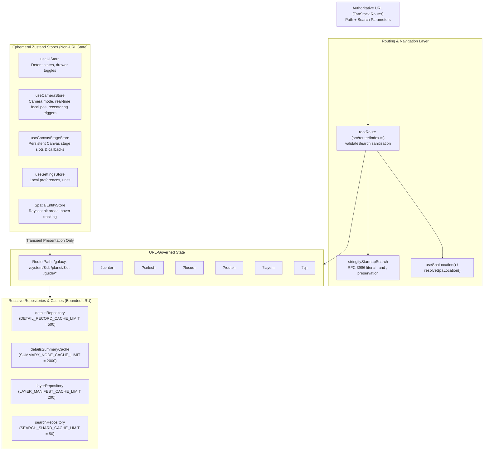

# Routing and State Architecture Specification

This document provides the authoritative architectural specification for Starmap's type-safe routing, URL grammar, search parameter sanitisation, state boundaries, reactive repository subscriptions, and bounded caching.

---

## 1. Single Source of Truth: TanStack Router (`DEC-R041`)

The URL is the definitive, authoritative Single Source of Truth for all navigational, selectional, and analytical state in Starmap (`DEC-R041`). Any user state that represents *what the user is looking at*, *what is selected*, or *how data is filtered* must be fully serialisable into and reproducible from the URL.



### 1.1 Deep-Linking & Reproducibility
Every significant view and inspection configuration produces a shareable, deterministic URL. Navigating directly to a URL—or using browser forward/back buttons—restores the exact camera focus, selected entities, active route waypoints, and analytical layers without relying on in-memory history states or local storage hacks.

---

## 2. Orthogonal URL Search Query Grammar

Starmap enforces a strictly orthogonal URL search query grammar governed by `DEC-R014a`–`l`. Each search parameter controls an independent dimension of state:

| Parameter | Type / Format | Purpose | Example |
| :--- | :--- | :--- | :--- |
| `?center=` | String (`slug` or `x,y,z`) | Defines the 3D focal centre or anchor entity around which space is oriented | `?center=sol` or `?center=0,0,0` |
| `?select=` | Comma-separated tokens (`<id>`, `layer:<slug>`, `route`) | Controls 3D reticle highlighting and selection membership (`DEC-R014f/g/i`) | `?select=sol,layer:project-hail-mary,route` |
| `?focus=` | String (`id`) | Pinned celestial focal target commanding primary reticle annotations and DetailsPanel | `?focus=tau-ceti` |
| `?route=` | Comma-separated waypoints (`<stop>[:<mode>]`) | Ordered sequence of waypoints and optional per-leg transit mode (`DEC-R014h`) | `?route=sol:torchship-1g,tau-ceti` |
| `?layer=` | String (`slug`) | Opens the `<LayerCard />` overlay only; never implicitly highlights 3D entities (`DEC-R014f`) | `?layer=project-hail-mary` |
| `?q=` | String | Free-text search query string | `?q=trappist` |
| `?searchCategory=` | String | Category filter for search queries (`all`, `stars`, `planets`, `structures`, `moons`, etc.) | `?searchCategory=planets` |

### 2.1 RFC 3986 Search String Serialiser (`stringifyStarmapSearch`)
Standard URI parameter encoders (such as `encodeURIComponent`) unnecessarily encode colons (`:`) to `%3A` and commas (`,`) to `%2C`. In Starmap, search queries frequently represent coordinate tuples, layer identifiers, and lists.

To maintain readable, idiomatic URLs, [`stringifyStarmapSearch`](../../src/router/index.ts) post-processes the router's query string output to preserve literal `:` and `,` characters per RFC 3986 §3.4. This ensures parameters such as `?select=sol,sirius-a` or `?route=sol:torchship-1g,tau-ceti` remain unescaped.

### 2.2 Out-of-Scope Guards & Legacy Prefix Stripping
To maintain clean orthogonality and eliminate backward-compatibility shims, `rootRoute.validateSearch` automatically strips legacy, deprecated, or out-of-scope prefixes from `select=`:
- Tokens beginning with `tag:`, `star-type:`, `planet-type:`, `collection:`, or `canon:` are pruned immediately during URL validation.
- Valid selections consist purely of clean entity slugs.

### 2.3 Multi-Value Guide Slugs (`DEC-R014a`–`l`)
Reference guide routes (`/guide/star-types/$starType`, `/guide/planet-types/$planetType`, `/guide/metrics/$metricId`, `/guide/hazards/$hazardId`) accept multi-value comma or plus-separated slugs (e.g. `/guide/star-types/o-type,b-type` or `/guide/hazards/radiation+flare`), allowing side-by-side comparative inspection in documentation views.

---

## 3. Strict `validateSearch` Sanitisation

All search parameters pass through strict type checking, trimming, and sanitisation at the root route before any view component mounts. The authoritative implementation is defined in [`rootRoute.validateSearch`](../../src/router/index.ts).

Key validation rules include:
1. **Free-text Query (`?q=`):** Stripped if empty or not a string.
2. **Search Category (`?searchCategory=`):** Preserved only when a non-empty string.
3. **Focal Target (`?focus=`):** Preserved only when a non-empty string identifier.
4. **Selection Set (`?select=`):** Comma-separated tokens are trimmed and filtered. Any token beginning with out-of-scope prefixes (`tag:`, `star-type:`, `planet-type:`, `collection:`, or `canon:`) is discarded immediately.
5. **Active Analytical Layer (`?layer=`):** Trimmed string; discarded if empty.
6. **Transit Route Waypoints (`?route=`):** Validated comma-delimited waypoints.
7. **Focal Centre Anchor (`?center=`):** Trimmed string coordinate or identifier; discarded if empty.

Malformed parameters, empty strings, and null characters are discarded, guaranteeing that downstream hooks receive pure, validated domain state.

---

## 4. State Boundaries & Ephemeral Stores

State in Starmap is strictly partitioned into two categories: **URL-Governed State** and **Ephemeral In-Memory State**. Global stores must never duplicate or conflict with URL parameters.

### 4.1 URL-Governed State
- Navigational routes (`/galaxy`, `/system/$systemId`, `/planet/$planetId`, `/guide/...`).
- Active focal entity (`?focus=`) and focal barycentre (`?center=`).
- Selected entity set (`?select=`).
- Route planning waypoints and compound departure modes (`?route=`, e.g. `?route=sol:torchship-1g,tau-ceti`).
- Analytical layer filters (`?layer=`).
- Search input text (`?q=`) and category (`?searchCategory=`).

### 4.2 Ephemeral Zustand Stores
Ephemeral stores hold high-frequency, transient, or hardware-specific state that is either non-serialisable or inappropriate for browser history:

1. **`useCameraStore` (`src/stores/useCameraStore.ts`):**
   - Real-time 60fps camera vectors (world position, look-at target, camera mode, azimuth, elevation, distance).
   - Recenter animation triggers and glide interpolations.
   - Panning and orbit velocities.
2. **`useUIStore` (`src/stores/useUIStore.ts`):**
   - Mobile `DetentSheet` active levels (`peek`, `partial`, `full`).
   - Filter drawer open/closed states.
   - Contextual modal dialogs.
3. **`useCanvasStageStore` (`src/stores/useCanvasStageStore.ts`):**
   - Active stage slot count and stage properties.
   - Imperative stage event callbacks (`onInspect`, `onSelect`, `onFocusChange`).
4. **`useSettingsStore` (`src/stores/useSettingsStore.ts`):**
   - Client-side preferences persisted to `localStorage` (preferred units, reduced motion overrides, debug overlays).
5. **`SpatialEntityStore` (`src/components/canvas/entity/SpatialEntityStore.ts`):**
   - Scoped per viewport instance via `SpatialEntityProvider` (`src/components/canvas/entity/SpatialEntityProvider.tsx`).
   - Dynamic 3D raycast hitarea bounding boxes, screen coordinates, and hover tracking.

---

## 5. Reactive Repository Subscriptions & Bounded Caching

Data fetching in Starmap operates through reactive repository hooks that shield the UI from network latency and shard topologies.

### 5.1 Reactive Repository Hooks
Views and domain panels consume data via dedicated hooks:
- **`useEntityDetails(id)`:** Resolves comprehensive astronomical dossiers for stars, planets, and minor bodies, backed by `detailsRepository` (`src/data/detailsRepository.ts`) and `detailsSummaryCache` (`src/data/detailsSummaryCache.ts`).
- **`useSystemData(systemId)`:** Fetches multi-body system manifests, Keplerian orbital parameters, and planetary hierarchies, backed by `detailsRepository` and `detailsSummaryCache`.
- **`useLoadedLayerManifests(search)` / `useLayerData`:** Retrieves analytical dataset layers, fictional canon records, and scientific overlays via `layerRepository` (`src/data/layerRepository.ts`).
- **`useSearchCorpus(category)`:** Loads compact search shards and performs client-side indexing via `searchRepository` (`src/data/searchRepository.ts`).

### 5.2 Bounded LRU Caches & Eviction Limits
To prevent unbounded memory growth during prolonged exploration across the 100pc volume, all repositories enforce strict Least-Recently-Used (LRU) cache boundaries defined in `src/config/cacheConfig.ts` (`AUD-090` & `DEC-R043`):

```typescript
export const DETAIL_RECORD_CACHE_LIMIT = 500;
export const SUMMARY_NODE_CACHE_LIMIT = 2_000;
export const SUMMARY_BUCKET_CACHE_LIMIT = 36;
export const DETAIL_BUCKET_CACHE_LIMIT = 36;
export const LAYER_MANIFEST_CACHE_LIMIT = 200;
export const LAYER_ENTITY_BUCKET_CACHE_LIMIT = 36;
export const SEARCH_SHARD_CACHE_LIMIT = 50;
export const SLUG_CACHE_LIMIT = 100_000;
```

When cache sizes exceed these limits, oldest unreferenced entries are automatically purged.

### 5.3 Request Deduplication & `AbortSignal` Cancellation
Repositories deduplicate in-flight fetch requests for the same shard or entity. If a user quickly navigates between entities (e.g. dragging across the starfield), obsolete requests are aborted cleanly via standard browser `AbortSignal` controllers, preventing race conditions and stale state overwrites.
