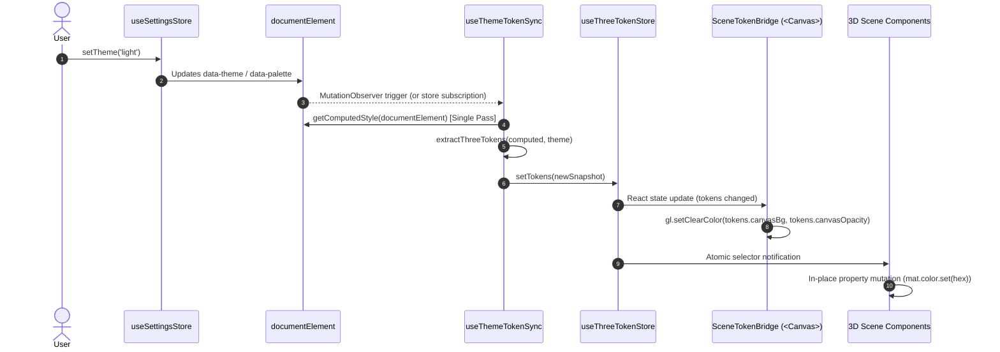

# Three.js Token Synchronisation Architecture

This document specifies the technical architecture for reading CSS custom properties (design tokens) from the DOM and synchronising them into WebGL/Three.js materials, custom shader uniforms, and scene clear colours without triggering WebGL pipeline stalls.

---

## 1. Architectural Objectives & Constraints

Starmap pairs a 2D DOM layout (HTML/CSS design system) with a persistent 3D WebGL viewport. Maintaining visual harmony across themes (`dark`, `light`, `amoled`) and palettes requires propagating CSS design tokens into the GPU pipeline under strict performance constraints.

```
┌─────────────────────────┐          ┌───────────────────────────┐
│     DOM & CSS Tokens    │          │     WebGL / Three.js      │
│  (:root, [data-theme])  │          │  (Materials, Shaders, gl) │
└────────────┬────────────┘          └─────────────▲─────────────┘
             │                                     │
             │   1. Theme Event / Mutation         │  4. In-Place Uniform
             ▼                                     │     Mutation (0ms)
┌─────────────────────────┐          ┌─────────────┴─────────────┐
│    ThemeTokenBridge     │─────────►│    useThreeTokenStore     │
│  (Single-Pass DOM Read) │  2. Parse│   (Immutable Snapshot)    │
└─────────────────────────┘     & Set└───────────────────────────┘
```

### Core Performance Invariants
1. **Single-Pass DOM Read (Zero Layout Thrashing):**
   `window.getComputedStyle()` forces a synchronous browser layout recalculation. Querying computed styles inside `useFrame`, `requestAnimationFrame`, or any render loop is strictly prohibited and enforced by static AST analysis (`npm run audit:r3f`). Tokens are read **strictly once per theme change event**.
2. **Zero Shader Recompilation & In-Place Mutation:**
   Theme transitions must **never** dispose of and recreate Three.js materials or remount the 3D scene (using dynamic React `key={theme}` is forbidden). Material recreation forces shader re-compilation and GPU pipeline binding stalls. All updates apply via **in-place uniform and property mutations** (`material.color.set(hex)`).
3. **Colour Space Correctness:**
   Design tokens are authored in modern OKLCH and sRGB CSS values. The parser resolves OKLCH and RGB/RGBA into hex strings and linear `THREE.Color` representations, avoiding washed-out colours or double-gamma distortion.
4. **Sub-Frame Reactivity:**
   Theme updates synchronise within a single frame to eliminate visual flickering between 2D interface panels and 3D celestial bodies.

---

## 2. Core Implementation Modules

The token synchronisation bridge is organised across focused TypeScript modules:

| Module | Responsibility | Key Exports |
| :--- | :--- | :--- |
| [`src/types/threeTokens.ts`](../../src/types/threeTokens.ts) | Canonical TypeScript definitions for token snapshots and line styles. | `ThreeTokenSnapshot`, `ThreeTheme`, `ThreeLineStyle` |
| [`src/utils/cssTokenParsers.ts`](../../src/utils/cssTokenParsers.ts) | Parses OKLCH, RGB, hex, durations, and pixel values; caches `THREE.Color` instances. | `parseCssColor`, `getThreeColor`, `parseCssDuration`, `parseCssPx` |
| [`src/utils/threeTokenDefaults.ts`](../../src/utils/threeTokenDefaults.ts) | Default theme token snapshot baselines (`dark`, `light`, `amoled`). | `createDefaultTokenSnapshot`, `DEFAULT_DARK_TOKEN_SNAPSHOT` |
| [`src/utils/extractThreeTokens.ts`](../../src/utils/extractThreeTokens.ts) | Single-pass extractor mapping DOM computed styles into `ThreeTokenSnapshot`. | `extractThreeTokens`, `readThreeTokensFromDom` |
| [`src/utils/extractThreeColorTokens.ts`](../../src/utils/extractThreeColorTokens.ts) | Resolves CSS `var(--...)` references recursively (depth $\le 10$) and extracts colour hexes. | `extractThreeColorTokens`, `resolveCssVar`, `readCssColor` |
| [`src/stores/useThreeTokenStore.ts`](../../src/stores/useThreeTokenStore.ts) | Lightweight Zustand store holding the current immutable token snapshot. | `useThreeTokenStore`, `ThreeTokenState` |
| [`src/components/canvas/useThemeTokenSync.ts`](../../src/components/canvas/useThemeTokenSync.ts) | Event-driven hook binding DOM theme changes to `useThreeTokenStore`. | `useThemeTokenSync` |
| [`src/components/canvas/ThemeTokenBridge.tsx`](../../src/components/canvas/ThemeTokenBridge.tsx) | DOM-side bridge provider and Canvas-side clear-colour synchroniser. | `ThemeTokenBridge`, `SceneTokenBridge` |

---

## 3. Synchronisation Lifecycle & Single-Pass Extraction

Synchronisation is entirely event-driven. The bridge decouples the DOM mutation lifecycle from the WebGL render loop:



### 3.1 Dual-Trigger Synchronization (`useThemeTokenSync`)
The `useThemeTokenSync` hook registers three coordinated listeners:
1. **Store Subscription:** Triggers immediately whenever `useSettingsStore.theme` updates.
2. **DOM `MutationObserver`:** Observes `document.documentElement` for attribute modifications on `data-theme`, `data-palette`, and `class`.
3. **Media Query Listener:** Observes `(prefers-reduced-motion: reduce)` changes to update animation timing tokens.

### 3.2 Single-Pass Extraction (`extractThreeTokens`)
When a theme transition occurs, `window.getComputedStyle(document.documentElement)` is invoked exactly once. `extractThreeTokens()` iterates through the defined token registry, evaluating custom properties, resolving nested CSS variables (`resolveCssVar`), and writing values into a new `ThreeTokenSnapshot`.

In `ThreeTokenSnapshot`, colour values are stored as immutable hex strings (e.g. `'#00e5ff'`) accompanied by alpha scalars (0–1). Caching and conversion to Three.js `THREE.Color` instances is handled on demand by `getThreeColor()` in `src/utils/cssTokenParsers.ts`.

---

## 4. Runtime In-Place Mutation Patterns

To prevent shader recompilation, canvas components consume tokens using atomic Zustand selectors and apply mutations directly to Three.js object instances.

### 4.1 Canvas Clear Colour Synchronisation (`SceneTokenBridge`)
Mounted inside the persistent `<Canvas>` (see [3D Canvas Management](3d-canvas-management.md)), `SceneTokenBridge` updates the WebGL context without remounting:

```tsx
export const SceneTokenBridge: React.FC<{ transparent?: boolean }> = ({ transparent = true }) => {
  const { gl } = useThree();
  const canvasBg = useThreeTokenStore((state) => state.tokens.canvasBg);
  const canvasOpacity = useThreeTokenStore((state) => state.tokens.canvasOpacity);

  useEffect(() => {
    if (!gl) return;
    if (transparent || canvasOpacity <= 0) {
      gl.setClearColor(0x000000, 0);
    } else {
      gl.setClearColor(canvasBg, canvasOpacity);
    }
  }, [gl, transparent, canvasBg, canvasOpacity]);

  return null;
};
```

### 4.2 Material In-Place Mutation
Components holding references to Three.js materials update properties via `useEffect`:

```tsx
// Atomic selector prevents re-rendering on unrelated token changes
const orbitColor = useThreeTokenStore((s) => s.tokens.orbitColor);

useEffect(() => {
  if (materialRef.current) {
    // In-place mutation: 0ms overhead, zero shader recompilation
    materialRef.current.color.set(orbitColor);
  }
}, [orbitColor]);
```

### 4.3 Custom Shader Uniforms
For custom shaders (`CartoLineMaterial`, reticle shaders), the uniforms dictionary maintains a permanent object reference allocated in `useRef` or static `useMemo`. Uniform values mutate their inner `.value` properties directly, preserving compiled GPU programs.

---

## 5. Architectural Guardrails

| Constraint | Enforcement Mechanism | Failure Mode Prevented |
| :--- | :--- | :--- |
| **No `getComputedStyle` in tick loops** | Static AST guard (`npm run audit:r3f`) | Browser layout thrashing; 60fps frame drops |
| **No dynamic `key={theme}` on `<Canvas>` or materials** | Code styleguide & code review | WebGL context loss and shader recompilation stalls |
| **Atomic Store Subscriptions** | AST guard `atomic-store-selectors` | Broad component re-renders on unrelated token changes |
| **Recursive Variable Resolution** | Depth cap ($\le 10$) in `resolveCssVar` | Infinite loops from circular CSS variable definitions |

For related documentation, see:
- [3D Canvas Management & WebGL Lifecycle](3d-canvas-management.md)
- [Design System Specification](../design/design-system.md)
- [WebGL, Three.js & R3F Style Guide](../../conductor/code_styleguides/webgl-r3f.md)
