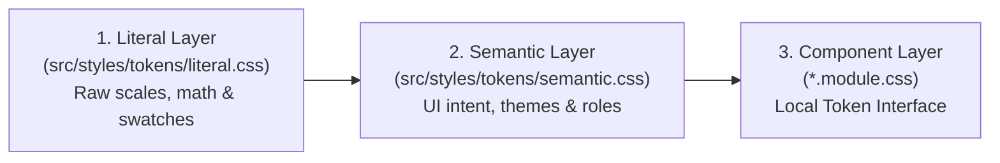
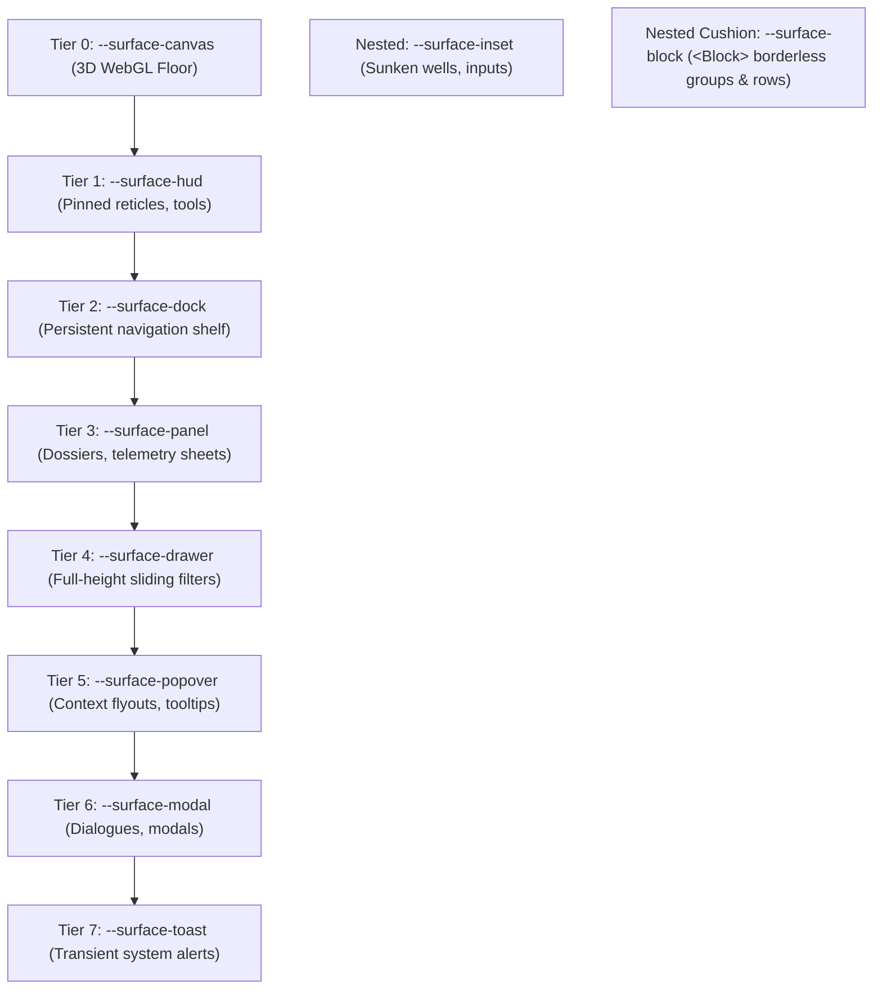
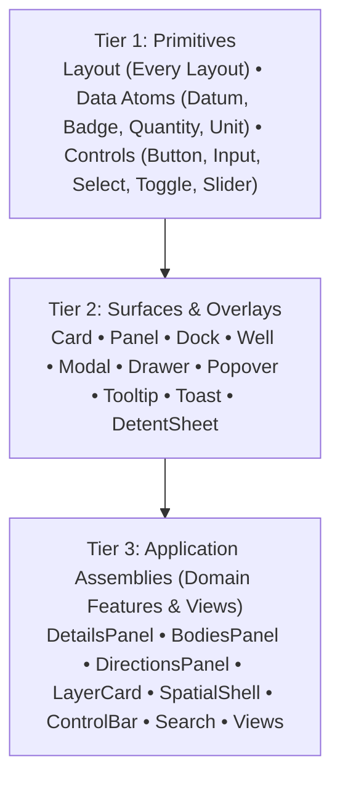

# Starmap Design System & Architecture Specification

This document defines the architectural foundations, spatial hierarchies, design tokens, and component guidelines for Starmap. It serves as the canonical design system specification for frontend developers and contributors.

---

## 1. System Overview & Cartographic Philosophy

Starmap is a technical, high-density schematic tool for navigating astronomical data and 3D celestial environments. Its design language is inspired by technical telemetry consoles, cartographic surveys (such as the Ordnance Survey), and schematic transport maps (such as the London Underground map).

### Core Principles

1. **Schematic Map over Realistic Void:** The interface avoids pseudo-cinematic glows and dark void clichés. Space is presented as an organised, measured coordinate environment with precise typography and clear spatial planes.
2. **Strict Colour Channel Separation:**
   - **Achromatic Text & Surfaces:** All typography, reading prose, container panels, and table structures operate on a high-contrast neutral axis. Text never borrows chromatic hues from data categories.
   - **Reserved Interactive Focus:** Vibrant chromatic accent (`--state-focus`) is strictly reserved for user tracking, active waypoints, and keyboard `:focus-visible` states.
   - **Scientific Indicators:** Chromatic hues are restricted strictly to telemetry condition/status (`--status-*`), observational confidence (`--confidence-*`), and astronomical domains (`--category-*`).
   - **Neutral Cartographic Chrome:** Grids, range circles, reticles, and coordinate axes are rendered in neutral lines so they never compete with thematic star data.
3. **Themed Solarized Palette & Multi-Palette OKLCH System:** Initial color literals are derived from Ethan Schoonover’s canonical Solarized palette, mapped in the perceptually uniform **OKLCH** color space to guarantee predictable lightness, uniform contrast, and clean alpha blending. Multi-palette themes extend this across four distinct spectral identities (`src/styles/tokens/palettes.css`).
4. **Pure Orthogonal Geometry:** All surfaces, containers, buttons, and inputs default to `--radius-none` (`0px`), creating a sharp, high-precision aesthetic.

---

## 2. Layout Paradigm: Adaptive Hybrid Console

Starmap adopts an **Adaptive Hybrid Console** model, combining the unobstructed immersion of a peripheral dock with the high-density utility of a split workstation.

### Foundational Components

1. **3D Viewport Canvas:**
   - The primary spatial environment for astronomical navigation.
   - Enforces screen-space hit-circle floors (`44px` diameter on touch, `28px` on mouse) with cluster fan-out and `14px` touch tap-slop so celestial nodes stay acquirable across portrait and landscape viewports.
2. **Persistent Console Dock (`ConsoleDock` on `<Dock>`):**
   - Anchors primary workspace navigation (`Map`, `Discover`, `Guide`) across spatial, search, and reference routes, preserving active map context across workspace switches.
   - Sits **coplanar** on the same physical plane as the stage, separated by a `1px` hairline divider: a `55px` bottom shelf on phone (`< 768px`) and a `63px` vertical left rail on tablet and desktop (`>= 768px`).
3. **Bilateral Stage Visor & Telemetry Containers:**
   - **Left Column (Active Locus & Dossier):** Aligns spatial `<Breadcrumbs>` directly above `DetailsPanel`, `DirectionsPanel`, `DiscoverPanel`, or `LayerCard`.
   - **Right Column (Target Discovery):** Pairs on-map `<Search>` with the `Bodies` drawer trigger below `1280px` (sliding open a headered right drawer that auto-closes on selection), and aligns `<Search>` directly above the docked `BodiesPanel` at `>= 1280px`.
   - **Orientation Readout:** Renders the 3D SVG `<Minimap>` on `>= 768px` and a compact `<VisorScalePill>` (focal distance + North reset) beside `<Breadcrumbs>` on `< 768px`.

### Telemetry Container Modes

The telemetry container supports two operational states across desktop and landscape environments:

- **Overlay Mode:**
  - Floats above the 3D canvas for rapid inspection and glanceable reads.
  - Enforces strict inline overflow containment (`overflow-x: clip`, `min-inline-size: 0`) and wrapping `<Datum>` slots so narrow tablet viewports (`768px–1024px`) never scroll panels horizontally off-screen.
- **Docked Mode:**
  - Locks flush with the viewport frame as a structural co-presence.
  - The 3D canvas bounds adjust so that space objects and telemetry exist side-by-side with zero occlusion.
  - **Camera Viewport Compensation:** The 3D camera controller recalculates its projection and framing to keep the active celestial target centred within the adjusted canvas area.

### Responsive Spatial Behaviours & Touch Targets

- **Coarse-Pointer Ergonomics (`@media (pointer: coarse)`):**
  - Interactive controls (`<Button>`, `<Input>`, `<Select>`, `<Toggle>`, `<Slider>`) and list rows enforce a `--size-touch-target-min` (`44px`) block-size floor, `16px` input text (`--text-ui-control-coarse-size`) to prevent browser auto-zoom, and pseudo-element hit-slop on inline links while keeping fine-pointer desktop chrome compact.
- **Mobile Bottom Sheet (`< 768px`):**
  - `DetailsPanel` docks coplanar directly above the bottom `ConsoleDock` via `<DetentSheet>`, measuring intrinsic heights with `ResizeObserver`:
    - **Peek:** Displays the drag handle, entity identity/badges row, and primary CTA buttons (`Details`, conditional `Centre`, `Directions`).
    - **Partial View:** Expands upward to a content-measured height (`<= 68dvh`), revealing the prose summary and `<PreviewPanel>` fluidly (`--detent-expand-progress`) *above* the CTA row while keeping the CTAs anchored at the exact same bottom Y coordinate.
    - **Full View:** Fills the stage above `ConsoleDock` and scrolls lower telemetry naturally below the overview frame.
- **Wide Displays (≥ 1920px):**
  - The container expands horizontally into **Multi-Bay** configurations (via `SpatialShell`), grouping related data sets when real estate permits.

---

## 3. Token Architecture & The 3-Tier Pipeline

Tokens are structured into a 3-tier pipeline that decouples raw mathematical measurements from UI intent and component implementations:



### 1. Literal Layer (`src/styles/tokens/literal.css`)
Contains pure scales, units, and swatches with zero domain or UI meaning:
- **Palette Swatches:** Canonical Solarized neutral and chromatic coordinates in OKLCH (`--palette-solarized-base03` through `--palette-solarized-base3`, `--palette-solarized-yellow`, `--palette-solarized-orange`, `--palette-solarized-red`, `--palette-solarized-magenta`, `--palette-solarized-violet`, `--palette-solarized-blue`, `--palette-solarized-cyan`, `--palette-solarized-green`).
- **Extended Accents & Hardware:** `--palette-accent-focus`, `--palette-accent-neutral`, `--palette-control-handle-dark/light`, `--palette-control-subtle-dark/light`.
- **Surface Families:** `--palette-surface-canvas-dark/light`, `--palette-surface-inset-dark/light`, `--palette-surface-chassis-dark/light`, `--palette-surface-slab-dark/light`, `--palette-surface-overlay-dark/light`, `--palette-surface-overlay-glass-dark/light`.
- **Mathematical Scales:** Computed dynamically via CSS `calc()`:
  - **Type Scale:** Major Third (`--type-ratio: 1.25`) from `--type-scale-neg-3` (~`8.19px`) to `--type-scale-4` (~`39.06px`).
  - **Spacing:** Fibonacci sequence (`--space-fib-1` [3px] through `--space-fib-13` [987px]).
  - **Geometry & Strokes:** `--radius-0` (`0px`) through `--radius-2` (`4px`), `--radius-pill-literal`; stroke widths `--stroke-width-0` through `--stroke-width-4`.
  - **Elevation & Directional Shadows:** Ambient and negative-spread directional shadows (`--elevation-hud`, `--elevation-dock`, `--elevation-panel`, `--elevation-drawer`, `--elevation-popover`, `--elevation-button`, `--elevation-modal`, `--elevation-toast`).
  - **Optics:** Paired opacity steps (`--opacity-0` through `--opacity-100`) and blur radii (`--filter-blur-0` through `--filter-blur-4`).
  - **Motion:** Discrete durations (`--time-0` [0ms] to `--time-4` [400ms]) and curves (`--curve-snappy`, `--curve-spatial`, `--curve-in`, `--curve-linear`).
  - **Stacking Context:** `--z-canvas` (0), `--z-hud` (10), `--z-dock` (20), `--z-panel` (30), `--z-drawer` (40), `--z-popover` (50), `--z-modal` (60), `--z-toast` (70).

### 2. Semantic Layer (`src/styles/tokens/semantic.css`)
Maps literal values to UI roles, spatial tiers, and domain meaning. **This is the boundary where Dark and Light themes diverge:**
- Changing a theme remaps semantic tokens to different literal swatches; component styles remain untouched.
- Standardised property suffixes are used uniformly across all categories: `-bg`, `-color`, `-width`, `-style`, `-shadow`, `-opacity`, `-backdrop-blur`, `-size`, `-tracking`, `-transform`, `-leading`.
- **Naming Pattern:** `--[category]-[target]-[property]` (e.g. `--surface-panel-bg`, `--text-content-hero-title-size`, `--space-inset-card`, `--chrome-range-ring-color`).

### Multi-Palette Theme Architecture (`src/styles/tokens/palettes.css`)
In addition to light and dark theme switching (`data-theme="dark" | "light"`), Starmap supports the calibrated `prodigy` palette (`data-palette="prodigy"`) configured in `src/styles/tokens/palettes.css` and managed via `src/styles/tokens/paletteTheme.ts`. The palette defines the surface hue angle, focus accent chromaticity, gradients, and specular rims without altering semantic token interfaces.

### 3. Component Layer (Local Token Interface)
Components declare localized CSS variables at the top of their CSS Module rules. Components consume **only** Semantic tokens, never Literal tokens.

### CSS Cascading Layers (`src/styles/layers.css`)
Global specificity is governed by CSS Cascading Layers declared at the application root:
```css
@layer reset, tokens, composition, blocks, exceptions, utilities;
```
1. **`reset`:** Browser normalisation, box-sizing, and body baseline rules.
2. **`tokens`:** Literal and semantic CSS variable declarations.
3. **`composition`:** Layout primitives (`<Stack>`, `<Cluster>`, `<Grid>`), controlling only external spatial flow.
4. **`blocks`:** Scoped component styles (CSS Modules), controlling internal aesthetics.
5. **`exceptions`:** State and variant modifiers (`[data-status]`, `[data-confidence]`). Sits above `blocks` so attribute overrides take precedence without specificity escalation.
6. **`utilities`:** Single-purpose helper classes (`.u-visually-hidden`), allowed to override block defaults when explicitly applied.

---

## 4. Spatial Surface Hierarchy

The viewport comprises an 8-tier stack of semantic container planes anchored above the 3D WebGL canvas:



### The Composite Surface Contract
Every surface tier obeys a composite profile formula:
$$\text{Surface Profile} = \text{Fill} + \text{Border Treatment} + \text{Elevation Shadow} + \text{Optics}$$

To prevent coupling and permit independent visual tuning, **each tier defines its own dedicated semantic properties**:
- Background: `--surface-<tier>-bg`
- Border Width: `--surface-<tier>-border-width`
- Border Color: `--surface-<tier>-border-color`
- Border Style: `--surface-<tier>-border-style`
- Shadow: `--surface-<tier>-shadow`
- Opacity: `--surface-<tier>-opacity`
- Backdrop Blur: `--surface-<tier>-backdrop-blur`
- Stacking: `--z-<tier>`

### Search Architecture & Modal Boundaries
Search operates across the interface via the persistent Dock and dedicated Search panel/view (`src/components/domain/Search/`: `SearchRoot`, `SearchPanel`, `SearchInput`, `SearchCategoryFilterSelect`, `SearchResults`, and single-anchor `SearchResultItem`). This coordinates query filtering and entity selection cleanly without interfering with underlying 3D viewport interactions. A floating `Cmd+K` / `Ctrl+K` Command Palette operating at the Modal tier (`--surface-modal`) remains a planned future backlog capability.

---

## 5. Mathematical Systems & Conventions

### 1. Modular Typography: Major Third (1.250)
Type scale steps are derived mathematically from a base of `1rem` (`16px`) via CSS `calc()`. Adjusting `--type-ratio` in the literal layer dynamically recalculates the entire scale:
- Decreasing steps: `--type-scale-neg-3` (~`8.2px`), `--type-scale-neg-2` (~`10.2px`), `--type-scale-neg-1` (`12.8px`)
- Baseline step: `--type-scale-0` (`16.0px`)
- Increasing steps: `--type-scale-1` (`20.0px`), `--type-scale-2` (`25.0px`), `--type-scale-3` (~`31.3px`), `--type-scale-4` (~`39.1px`)

Semantic typography is classified across three dedicated application domains:
1. **The 3D Map Itself (`--text-map-*`):** Celestial nodes (`system`, `planet`, `satellite`, `phenomenon`, `structure`, `vehicle`) and cartographic labels (`region`, `scale`, `coordinate`, `annotation`).
2. **Data Content (`--text-content-*`):** Headers (`hero-title`, `subtitle`, `section-title`, `eyebrow`), telemetry metrics (`metric-value`, `metric-unit`, `data-label`, `data-value`, `uncertainty`), prose (`body-lead`, `body`), and catalogue metadata (`badge`, `catalog-id`, `footnote`).
3. **UI Chrome (`--text-ui-*`):** Navigation (`nav-tab`, `breadcrumb`, `breadcrumb-active`), search (`search-input`, `search-placeholder`), buttons, and controls (`input`, `caption`).

### 2. Spacing: Pure Additive Fibonacci Sequence
Spacing follows the Fibonacci sequence ($a + b = c$) derived dynamically via `calc()`, guaranteeing harmonious optical proportions:
- `--space-fib-1` (`3px`), `--space-fib-2` (`5px`), `--space-fib-3` (`8px`), `--space-fib-4` (`13px`), `--space-fib-5` (`21px`), `--space-fib-6` (`34px`), `--space-fib-7` (`55px`).

Semantic spacing maps these steps into four layout categories:
- **Insets:** `--space-inset-card`, `--space-inset-panel`, `--space-inset-control-x/y`, `--space-inset-cell-x/y`, `--space-inset-badge`, `--space-inset-toolbar`.
- **Stack Gaps:** `--space-stack-dense`, `--space-stack-compact`, `--space-stack-control`, `--space-stack-default`, `--space-stack-section`.
- **Cluster Gaps:** `--space-cluster-dense`, `--space-cluster-compact`, `--space-cluster-default`, `--space-cluster-loose`.
- **Layout Gutters:** `--space-grid-gap`, `--space-viewport-edge`.

### 3. Symmetrical Opacity & Backdrop Blur Pairs
To support translucent and glassmorphism themes without stylesheet refactoring, every opacity token is paired symmetrically with a backdrop blur token:
- Surfaces: `--surface-<tier>-opacity` paired with `--surface-<tier>-backdrop-blur`.
- Overlays & Badges: `--ui-badge-fill-opacity` paired with `--ui-badge-backdrop-blur`, `--ui-tooltip-opacity` paired with `--ui-tooltip-backdrop-blur`.
- Values obey standard CSS direction: `0` = completely transparent, `1.0` = completely solid.

### 4. Technical Motion & Accessibility
- **Durations:** Discrete steps for feedback (`--motion-duration-feedback: 75ms`), interactions (`--motion-duration-interactive: 150ms`), overlays (`--motion-duration-overlay: 250ms`), and spatial transitions (`--motion-duration-spatial: 400ms`).
- **Easings:** Snappy technical deceleration (`--motion-ease-default: cubic-bezier(0.2, 0, 0, 1)`).
- **Reduced Motion:** When `@media (prefers-reduced-motion: reduce)` is active, all durations clamp to `0ms` automatically at the root.

---

## 6. Component Taxonomy

Starmap enforces a strict 3-tier component hierarchy, fully aligned with [`conductor/code_styleguides/components.md`](../../conductor/code_styleguides/components.md):



### Tier 1: Primitives (Base Elements)
Atomic, domain-agnostic elements with no knowledge of stars, orbits, or application state.
- **Layout Primitives (Every Layout):** Manage spatial rhythm and wrapping without media queries.
  - `<Stack>`: Vertical flow with uniform gap between siblings.
  - `<Cluster>`: Inline flex wrap with uniform gap; children maintain intrinsic size.
  - `<Sidebar>`: Two-column layout pairing a fixed/intrinsic sidebar with a fluid content area.
  - `<Switcher>`: Switches children from horizontal row to vertical stack below a container threshold.
  - `<Grid>`: Responsive auto-fit CSS grid (`repeat(auto-fit, minmax(var(--min), 1fr))`).
  - `<Center>`: Horizontally centred container with `max-inline-size` and gutter padding.
  - `<Cover>`: Minimum 100% block-height container centring a principal element with optional header/footer.
  - `<Frame>`: Aspect-ratio locked container for previews and reticles.
  - `<Reel>`: Horizontal scroll container with scroll snap points.
  - `<Box>`: Foundational wrapper providing token-driven padding, border, and background slots.
  - `<Imposter>`: Absolute/fixed overlay anchored to a container or viewport.
  - `<Icon>`: Inline container aligning SVGs with adjacent typography.
- **Data Atoms:**
  - `<Datum>`: Horizontal key-value row for dense parameter listings.
  - `<Quantity>`: Formatted numeric quantity value with optional paired `<Unit>`.
  - `<Unit>`: Scientific unit presentation with optional contextual guide navigation.
  - `<Badge>`: Status, confidence, or category metadata chip.
  - `<DataTable>`: Tabular telemetry grid with rigid column alignment.
  - `<Heading>` / `<Typography>` / `<Kbd>`: Semantic typography atoms.
- **Control Primitives:** `<Button>`, `<Input>`, `<Select>`, `<Toggle>`, `<Slider>`.

### Tier 2: Surfaces & Overlays (Spatial Planes)
Containers that implement Tier profiles (fill, border, shadow, elevation, and optics):
- Surfaces: `<Card>` (`--surface-panel`), `<Panel>` (`--surface-panel`), `<Dock>` (`--surface-dock`), `<Well>` (`--surface-inset`).
- Overlays: `<Modal>` (`--surface-modal`), `<Drawer>` (`--surface-drawer`), `<Popover>` (`--surface-popover`), `<Tooltip>` (`--surface-popover`), `<Toast>` (`--surface-toast`).
- Responsive Detents: `<DetentSheet>` (`--surface-panel` / `--surface-drawer`), providing mobile vertical detent states (`peek`, `partial`, `full`) and desktop side-sheet integration.

### Tier 3: Application Assemblies (Domain Features & Views)
Starmap-specific assemblies that bind live data, astronomical repositories, and application state to Tier 2 surfaces and Tier 1 primitives:
- Domain feature panels, assemblies, and macro layout shells (e.g. `SpatialShell`, `DetailsPanel`, `BodiesPanel`, `DirectionsPanel`, `LayerCard`, `ControlBar`, `Minimap`, `Search`, `PreviewPanel`).
- Comprehensive component documentation, props, and interactive variations are maintained live in Storybook and inspected directly under [`src/components/domain/`](../../src/components/domain/).

---

## 7. Developer Guidelines & Architectural Guardrails

Starmap enforces strict engineering guardrails across styling, component architecture, and type safety. Detailed specifications live in the Conductor styleguides:

- **Zero Outer Margins & CUBE CSS:** Components must never set external `margin`, positioning offsets, or dynamic class concatenation. See [`conductor/code_styleguides/html-css.md`](../../conductor/code_styleguides/html-css.md).
- **Interface Primitives & Regulated Badges:** Views and domain assemblies must compose Tier 1 primitives rather than raw HTML controls (`<input>`, `<select>`, `<button>`). Domain classifications must use regulated badges (`<CelestialBadge>`, `<SpectralBadge>`, `<HazardBadge>`). See [`conductor/code_styleguides/components.md`](../../conductor/code_styleguides/components.md).
- **Strict Zero-`className` and Zero-`style` on Tier 1 Primitives:** Tier 1 primitives encapsulate their scoped CSS Modules statically and reject external `className` or `style` props (`DEC-R050`). See [`conductor/code_styleguides/components.md`](../../conductor/code_styleguides/components.md).
- **Mandatory Component File Quads:** Every component in `src/components/interface/**` and `src/components/domain/**` must adhere to the 4-file quad (`.tsx`, `.module.css`, `.stories.tsx`, `.test.tsx`). See [`conductor/code_styleguides/components.md`](../../conductor/code_styleguides/components.md).
- **Strict DOM Testing & TypeScript:** Tests run in `jsdom` using `@testing-library/react` with zero `renderToString`. See [`conductor/code_styleguides/typescript.md`](../../conductor/code_styleguides/typescript.md).

---

## 8. Step-by-Step Component Implementation Recipe

When creating a new UI component in Starmap, follow this recipe (exemplified by `<Datum>`):

### 1. Component TypeScript Definition
```tsx
// src/components/interface/information/Datum/Datum.tsx
import type { HTMLAttributes, ReactNode } from 'react';
import { Quantity } from '../Quantity/Quantity';
import { ConfidencePip, type ConfidenceLevel } from '../ConfidencePip/ConfidencePip';
import styles from './Datum.module.css';

export interface DatumProps extends Omit<HTMLAttributes<HTMLDivElement>, 'className' | 'style'> {
  label: ReactNode;
  value: ReactNode;
  unit?: ReactNode;
  status?: 'nominal' | 'caution' | 'critical' | 'info';
  size?: 'sm' | 'md';
  valueTestId?: string;
  confidence?: ConfidenceLevel;
  'data-testid'?: string;
}

export const Datum = ({
  label,
  value,
  unit,
  status,
  size = 'md',
  valueTestId,
  confidence,
  ...rest
}: DatumProps) => {
  const valueElement = (
    <Quantity
      value={value}
      unit={unit}
      data-testid={valueTestId}
    />
  );

  return (
    <div
      className={styles.datum}
      data-datum="true"
      data-status={status}
      data-size={size}
      {...rest}
    >
      <span className={styles.label}>{label}</span>
      {confidence ? (
        <span className={styles.valueGroup}>
          {valueElement}
          <ConfidencePip confidence={confidence} size="sm" />
        </span>
      ) : (
        valueElement
      )}
    </div>
  );
};
```

### 2. Component CSS Module
```css
/* src/components/interface/information/Datum/Datum.module.css */
@layer blocks {
  .datum {
    /* 1. Local Token Interface */
    --datum-font-family: var(--font-interface);
    --datum-font-size: var(--text-content-data-value-size);
    --datum-label-font-size: var(--text-content-data-label-size);
    --datum-label-color: var(--content-muted);
    --datum-value-color: var(--content-default);
    --datum-value-weight: 500;
    --datum-border-color: var(--border-color-subtle);
    --datum-border-width: var(--border-width-1);
    --datum-border-style: var(--border-style-provisional);
    --datum-padding-y: var(--space-inset-cell-y);
    --datum-unit-font-size: var(--text-content-metric-unit-size);

    --quantity-gap: var(--space-gap-datum);
    --quantity-color: var(--datum-value-color);

    display: flex;
    justify-content: space-between;
    align-items: baseline;
    padding-block: var(--datum-padding-y);
    border-block-end: var(--datum-border-width) var(--datum-border-style) var(--datum-border-color);
    font-family: var(--datum-font-family);
    font-size: var(--datum-font-size);
    font-weight: var(--datum-value-weight);
    margin: 0;
  }

  .label {
    color: var(--datum-label-color);
    font-size: var(--datum-label-font-size);
    white-space: nowrap;
  }

  .valueGroup {
    display: inline-flex;
    align-items: center;
    gap: var(--space-gap-datum);
  }
}

@layer exceptions {
  .datum[data-status="nominal"] {
    --datum-value-color: var(--status-nominal);
    --quantity-color: var(--status-nominal);
  }
  .datum[data-status="caution"] {
    --datum-value-color: var(--status-caution);
    --quantity-color: var(--status-caution);
  }
  .datum[data-status="critical"] {
    --datum-value-color: var(--status-critical);
    --quantity-color: var(--status-critical);
  }
  .datum[data-status="info"] {
    --datum-value-color: var(--status-info);
    --quantity-color: var(--status-info);
  }

  .datum[data-size="sm"] {
    --datum-font-size: var(--type-scale-neg-2);
    --datum-padding-y: var(--space-fib-1);
  }
}
```

---

## 9. Contributor Checklist (Before Submitting PRs)

Before opening any PR involving UI or styling, verify the following:
- [ ] **Zero Magic Numbers:** No hardcoded hex values (`#fff`), pixel spacing (`margin: 12px`), or arbitrary font sizes. Everything consumes `var(--token)`.
- [ ] **No Outer Margins:** Component CSS sets zero outer `margin`. Spacing is managed by `<Stack>`, `<Cluster>`, or `<Box>`.
- [ ] **Layers Enforced:** Component styles are wrapped in `@layer blocks { ... }` and exceptions in `@layer exceptions { ... }`.
- [ ] **Local Token Interface:** Custom properties are declared at the top of the component block and mutated by exceptions.
- [ ] **Semantic Props to Data Attributes:** Variants and states are bound to HTML `data-*` attributes, not class concatenation.
- [ ] **Tabular Numerals:** All numeric telemetry uses `var(--font-data)` and `font-variant-numeric: tabular-nums`.
- [ ] **Quality Suite Clean:** `npm run lint`, `npm run typecheck`, and `npm run test:coverage` pass with zero errors.
